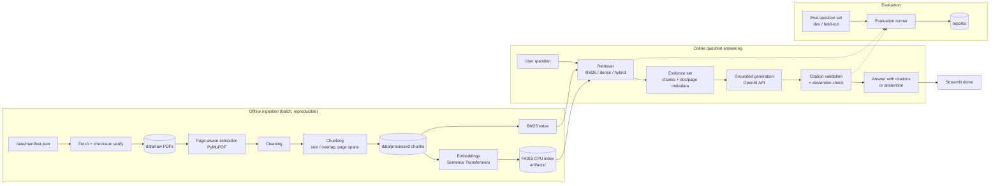
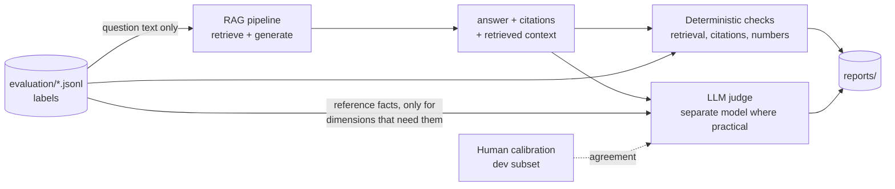

# Architecture

> **Status:** Stage 1 complete; Stage 2 Commits 2.1–2.2 implemented. Implemented:
> - `founderlens.config` and the `python -m founderlens` entry point;
> - `founderlens.corpus` (manifest, acquisition, integrity validation);
> - `founderlens.evaluation` (dataset schema and validation);
> - `founderlens.ingestion` (raw page-level extraction, normalization, table
>   candidates). Everything else below is the **planned** design and
> may change as evaluation results come in.

## Overview

## Offline ingestion pipeline (Stage 2)

1. **Manifest-driven fetch** *(implemented in Commit 1.2)*. `data/manifest.json`
   lists four official PDFs with provenance, SHA-256, size and page count.
   `founderlens.corpus.download` fetches over HTTPS from allowlisted hosts
   only, re-checks redirects, writes to a temporary file, verifies, then
   renames into `data/raw/` (git-ignored). `founderlens.corpus.validate`
   re-verifies hash, size, PDF signature, readability, encryption and page
   count, and is read-only.
2. **Page-aware extraction** *(implemented in Commit 2.1;
   [ingestion.md](ingestion.md))*. `founderlens.ingestion.extract`:
   - validates the corpus;
   - re-hashes each PDF and opens it from memory;
   - extracts every physical page with
     `Page.get_text("text", sort=True, flags=67)`;
   - writes one typed `PageRecord` per page (`page_id` =
     `{document_id}:p{NNNN}`) to `data/processed/pages.raw.jsonl`, atomically;
   - writes diagnostics to `reports/extraction_report.json`.

   The text is raw, not cleaned.
3. **Normalization and table candidates** *(implemented in Commit 2.2;
   [ingestion.md](ingestion.md#commit-22-layout-aware-normalization))*.
   `founderlens.ingestion.normalize`:
   - validates the corpus and the raw artifact, and rejects stale raw text by
     re-extracting each page;
   - applies conservative, idempotent text rules: LF, NFC, trailing
     whitespace, blank-line runs. Column padding is kept, and there is no
     dehyphenation or header/footer removal;
   - adds table candidates from word coordinates
     (`founderlens.ingestion.tables`), each `structured`, `uncertain` or
     `fallback`;
   - writes `data/processed/pages.normalized.jsonl`, keeping the text and
     the table view as separate fields.
4. **Chunking.** Configurable size and overlap; each chunk records its
   document and page span so citations can be checked.
5. **Persisted output** in `data/processed/`, regenerable from raw inputs.

## Online question-answering pipeline (Stages 3–5)

1. **Retrieve** top-k chunks with BM25, dense search, or a hybrid.
2. **Assemble evidence** with document and page metadata.
3. **Generate** an answer constrained to the evidence.
4. **Validate citations**: each cited `(document, page)` must exist in the
   evidence set; unsupported claims trigger abstention or rejection.
5. **Abstain** when evidence is insufficient instead of guessing.

## Retrieval

- **BM25 baseline (Stage 3).** Cheap, transparent, strong on exact financial
  terms (tickers, line items, fiscal years). It is the baseline every other
  method must beat on the development split.
- **Dense retrieval (Stage 3).** Sentence Transformers embeddings with a FAISS
  CPU index (exact inner-product search is sufficient at this corpus size).
  Handles paraphrase and semantic queries BM25 misses.
- **Hybrid (optional).** Score or rank fusion, adopted only if evaluation
  shows a measurable gain.

## Generation and citation interfaces (planned, Stage 4)

Indicative contracts, not yet implemented:

- `retrieve(question, k) -> list[RetrievedChunk]` — chunk text, score,
  `document_id`, `page_start`, `page_end`.
- `answer(question, evidence) -> GroundedAnswer` — answer text, list of
  citations `(document_id, page)`, `abstained: bool`, token usage, latency.

The OpenAI client is the only external service and is injected so tests can
substitute a fake.

## Evaluation workflow

**Implemented (Commit 1.2):** `evaluation/questions.{dev,test}.jsonl`, 40
questions in five categories, reviewed by the project owner and frozen at
dataset v1.0.0, with fact-level page evidence. Their
hashes are recorded in `evaluation/dataset.json`, and
`founderlens.evaluation.validate` checks structure, distribution, evidence
references and file integrity.

**Planned (Stage 6):** a hybrid harness, specified in
[`evaluation_protocol.md`](evaluation_protocol.md):

1. deterministic retrieval metrics (page-level Recall@k, MRR, fact coverage);
2. deterministic citation validation;
3. reference-based answer checks (numeric parsing against required facts);
4. LLM-as-a-Judge, with one call and schema per dimension: faithfulness,
   correctness, relevance, completeness, citation support, abstention;
5. human calibration of the judge on predefined development items;
6. operational metrics (latency, tokens, cost).

**Isolation boundary.** The pipeline receives only the question text. Labels,
reference answers and evidence never reach retrieval, generation or an index.
The judge receives references only for correctness and abstention; it judges
faithfulness against the retrieved context. Evaluated text is treated as
untrusted data, and malformed judge output is recorded as an error, never a
pass.

## Module boundaries

| Module (planned) | Responsibility | Depends on |
|------------------|----------------|------------|
| `config` *(implemented)* | Project root and path resolution | stdlib |
| `corpus` *(implemented)* | Manifest, verified acquisition, integrity validation | config, stdlib `urllib`, PyMuPDF (validity and page counts) |
| `evaluation` *(schema and validation implemented)* | Dataset schema and validation; metrics, runner and judge planned | config, corpus manifest |
| `ingestion` *(extraction, normalization implemented)* | Extract (done), normalize and table candidates (done), chunk | config, corpus, PyMuPDF |
| `retrieval` | BM25, dense, FAISS index | config, chunks |
| `generation` | Prompting, OpenAI calls, citations, abstention | retrieval types |
| `evaluation` | Metrics, runner, reports | retrieval, generation |
| `app` | Streamlit UI | generation |

Dependencies point one way (ingestion → retrieval → generation → evaluation/app).
Modules are created only in the stage that needs them.

## Data flow and storage

| Location | Contents | Tracked in git |
|----------|----------|----------------|
| `data/manifest.json` | Corpus definition (v1.0.0) | Yes |
| `evaluation/` | Questions, metadata and hashes | Yes |
| `data/raw/` | Downloaded PDFs | No |
| `data/processed/` | `pages.raw.jsonl` (raw page text), `pages.normalized.jsonl` (normalized text + table candidates); later chunks | No |
| `artifacts/` | Indexes, embeddings | No |
| `reports/` | Extraction and normalization reports, evaluation outputs | No (summaries copied to docs when verified) |

## Design decisions and trade-offs

- **Fixed corpus, no uploads.** Enables reproducible evaluation and removes
  multi-tenant and security surface area; limits generality.
- **No database.** Files + FAISS are sufficient at this scale and keep setup
  to `pip install`; would not scale to large or frequently changing corpora.
- **No orchestration framework** (LangChain/LangGraph). The pipeline is
  short; plain functions are easier to test, type-check and explain.
- **FAISS CPU, exact search.** No GPU requirement; approximate indexes are
  unnecessary for a small corpus.
- **BM25 first.** A strong, interpretable baseline makes dense-retrieval gains
  measurable rather than assumed.
- **Stdlib configuration.** A frozen dataclass avoids a settings-library
  dependency; revisit only if configuration grows substantially.
- **Stdlib downloader.** `urllib` with an explicit host allowlist and redirect
  checks avoids an HTTP-client dependency for four files.
- **PyMuPDF pinned at 1.28.2.** The 2.x line pulls in onnxruntime, numpy and
  networkx unconditionally. 1.28.x has no transitive dependencies. Its AGPL
  license must be resolved before public deployment (see README).
- **Metadata, not documents, in git.** The PDFs are fetched from official
  sources and verified by SHA-256 rather than redistributed.
