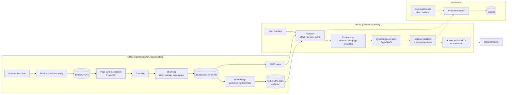
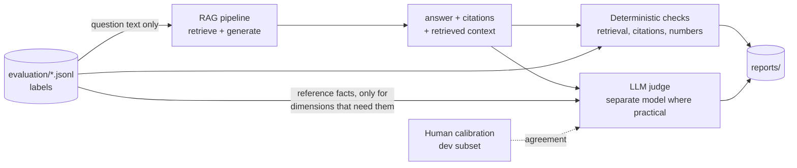

# Architecture

> **Status:** Stage 1 complete; Stage 2 (Commits 2.1–2.3) implemented;
> Stage 3 Commits 3.1 (BM25 baseline), 3.2 (chunking V2 and the full-corpus
> embedding pipeline), 3.3 (exact dense retrieval) and 3.4 (development-split
> retrieval benchmark) implemented; Commit 4.1 (RRF hybrid retrieval) and
> Commit 4.2 (three-way development benchmark) implemented; Commit 4.3
> selects BM25 on V2 (top 10) as the retrieval path for generation
> ([retrieval_strategy.md](retrieval_strategy.md)), completing Stage 3.
> Generation (Stage 4) is not implemented.
> Implemented:
> - `founderlens.config` and the `python -m founderlens` entry point;
> - `founderlens.corpus` (manifest, acquisition, integrity validation);
> - `founderlens.evaluation` (dataset schema and validation, page-level
>   retrieval metrics, the development-split retrieval benchmark);
> - `founderlens.ingestion` (raw page-level extraction, normalization, table
>   candidates, page-aware chunking);
> - `founderlens.retrieval` (lexical tokenizer, in-memory BM25 baseline,
>   shared result type, token-length audit, embedding artifact pipeline and
>   exact dense retrieval, RRF hybrid retrieval).
>
> Everything else below is the **planned** design and may change as
> evaluation results come in.

## Overview



## Offline ingestion pipeline (Stage 2)

1. **Manifest-driven fetch** *(implemented in Commit 1.2)*. `data/manifest.json`
   lists four official PDFs with provenance, SHA-256, size and page count.
   `founderlens.corpus.download` fetches over HTTPS from allowlisted hosts
   only, re-checks redirects, writes to a temporary file, verifies, then
   renames into `data/raw/` (git-ignored). `founderlens.corpus.validate`
   re-verifies hash, size, PDF signature, readability, encryption and page
   count, and is read-only.
2. **Page-aware extraction** *(implemented in Commit 2.1;
   [ingestion.md](ingestion.md))*. `founderlens.ingestion.extract`:
   - validates the corpus;
   - re-hashes each PDF and opens it from memory;
   - extracts every physical page with
     `Page.get_text("text", sort=True, flags=67)`;
   - writes one typed `PageRecord` per page (`page_id` =
     `{document_id}:p{NNNN}`) to `data/processed/pages.raw.jsonl`, atomically;
   - writes diagnostics to `reports/extraction_report.json`.

   The text is raw, not cleaned.
3. **Normalization and table candidates** *(implemented in Commit 2.2;
   [ingestion.md](ingestion.md#commit-22-layout-aware-normalization))*.
   `founderlens.ingestion.normalize`:
   - validates the corpus and the raw artifact, and rejects stale raw text by
     re-extracting each page;
   - applies conservative, idempotent text rules: LF, NFC, trailing
     whitespace, blank-line runs. Column padding is kept, and there is no
     dehyphenation or header/footer removal;
   - adds table candidates from word coordinates
     (`founderlens.ingestion.tables`), each `structured`, `uncertain` or
     `fallback`;
   - writes `data/processed/pages.normalized.jsonl`, keeping the text and
     the table view as separate fields.
4. **Chunking** *(implemented in Commit 2.3;
   [ingestion.md](ingestion.md#commit-23-page-aware-chunking))*.
   `founderlens.ingestion.chunk`:
   - validates the corpus and the normalized artifact against the manifest,
     with no PDF re-extraction;
   - splits each page's `normalized_text` into word windows. Size and overlap
     are configurable (default 120/24 whitespace words), and boundaries
     prefer paragraph, then line, then word breaks;
   - writes `data/processed/chunks.jsonl`. Each chunk is an exact
     `[start_char, end_char)` slice of one page, with a stable ID and a
     configuration ID;
   - validates coverage and overlap, and writes
     `reports/chunking_report.json`.

   Table candidates are not indexed. BM25 and dense retrieval share this one
   collection.
5. **Persisted output** in `data/processed/`, regenerable from raw inputs.

## Online question-answering pipeline (Stages 3–5)

1. **Retrieve** up to ten ranked candidate chunks with the frozen policy
   (BM25 on V2, `founderlens.retrieval.policy`; see
   [Selected retrieval policy](#selected-retrieval-policy-commit-43)). Dense
   and hybrid retrieval remain evaluated alternatives, not used here.
2. **Assemble evidence** with document and page metadata.
3. **Generate** an answer constrained to the evidence.
4. **Validate citations**: each cited `(document, page)` must exist in the
   evidence set; unsupported claims trigger abstention or rejection.
5. **Abstain** when evidence is insufficient instead of guessing.

## Retrieval

### BM25 lexical baseline (implemented in Commit 3.1)

`founderlens.retrieval` is a transparent baseline over the chunk collection.
It is expected to be strong on exact financial terms, but no retrieval quality
has been measured yet; formal benchmarking is Commit 3.4.

**Modules.**
- `tokenize`: the shared lexical tokenizer.
- `schema`: `RetrievalResult` and validated `ChunkCollection` loading, both
  reusable by dense retrieval.
- `bm25`: `BM25Config`, `BM25Retriever` and the command-line interface.

**Library.** `rank-bm25==0.2.2` `BM25Okapi`, unmodified, with
`numpy==2.5.4`. Defaults are `k1 = 1.5`, `b = 0.75`, `epsilon = 0.25`,
`top_k = 5`.
- IDF is `ln((N − n + 0.5)/(n + 0.5))`. The library replaces negative values
  (terms in more than half of the chunks) with `epsilon × mean IDF`.
- A term in exactly half of the chunks has IDF 0.
- Document length is counted in lexical tokens, not ingestion words.
- `bm25_config_id` hashes the algorithm, library version, tokenizer version
  and scoring parameters. Index identity also needs the chunk artifact
  SHA-256; both are recorded.

**Tokenizer (version 1).** `str.casefold()`, then the regex
`[^\W_]+(?:[.,-][^\W_]+)*`: Unicode letter/digit runs, joined by a single
internal `.`, `,` or `-`. Everything else separates tokens.

| Text | Tokens |
|------|--------|
| `NVIDIA` | `nvidia` |
| `Blackwell` | `blackwell` |
| `FY2025` | `fy2025` |
| `Q4` | `q4` |
| `$39,331` | `39,331` |
| `37.5%` | `37.5` |
| `non-GAAP` | `non-gaap` |
| `Google Cloud` | `google`, `cloud` |
| `(146)` | `146` |
| `NVIDIA’s` | `nvidia`, `s` |

Dropping `$`, `%` or the parentheses of a negative value loses meaning in
the tokens. Results return the original chunk text, which keeps it.
- Numbers are not converted: `39,331` and `39331` do not match.
- There is no stemming, stop-word removal or synonym expansion.

**Index.** The validated `chunks.jsonl` is loaded and checked against the
manifest and the normalized pages:
- unique IDs and a single chunking configuration;
- manifest metadata;
- manifest, page and chunk order;
- exact source spans and full page coverage.

Only the original chunk text is indexed, with no metadata, labels or table
duplicates. The index is built in memory once per retriever and reused for
every query. A chunk with no lexical token would be left out and listed; on
corpus v1.0.0 all 162 chunks have tokens.

**Ranking.**
- A chunk **matches** when it contains a query token. Only matching chunks
  are returned, never padding.
- Matches are ranked by descending raw score. Matching is decided by token
  presence, not by score sign, so a match with a zero or negative score is
  still returned.
- Ties keep collection order (manifest document, page, chunk).
- At most `top_k` results are returned, fewer if fewer chunks match.
- There is no page deduplication before the cut, as in evaluation protocol
  v1.1.
- Empty, punctuation-only and fully out-of-vocabulary queries return no
  results. An empty result is not evidence that the corpus cannot answer.
- Scores are ranking scores, not probabilities. They are not normalized or
  thresholded, and they are not used for abstention.

**Command line.**

```powershell
python -m founderlens.retrieval.bm25 --query "NVIDIA Blackwell" --top-k 5
python -m founderlens.retrieval.bm25 --query "Google Cloud" --json
python -m founderlens.retrieval.bm25 --smoke   # reports/bm25_smoke_report.json
```

Also: `--chunks`, `--k1`, `--b`, `--epsilon`, `--project-root`. Invalid
parameters exit `2`; a missing or invalid collection exits `1`.

**Smoke run (corpus v1.0.0).** Exploratory queries written for the smoke
test, not evaluation questions. Index facts:
- 162 of 162 chunks indexed;
- vocabulary of 2,577 tokens;
- 17–127 lexical tokens per chunk (mean 95.7);
- index built in about 8 ms; one query takes about 0.1–0.25 ms (machine
  dependent).

Query observations:
- `NVIDIA Blackwell`: NVIDIA chunks only.
- `Google Cloud` and `free cash flow`: Alphabet segment and cash-flow pages
  first.
- `Google Cloud`: the Q3 and Q4 page-7 chunks tie exactly (6.9098), and
  collection order puts Q3 first.
- `fourth quarter fiscal 2025`: an NVIDIA Q3 chunk ranks first, because the
  Q3 release discusses its fourth-quarter outlook. This is a lexical
  limitation, not an error.
- `zyzzyva quokka` and `$ % ( ) -`: no results.

These observations show the retriever works. They are not relevance
judgements.

**Known limitations.**
- Lexical matching only: no paraphrase or synonym handling, and number
  formats must match exactly.
- Common words (`operating`, `income`, `2024`) get low or floored IDF, and
  query stop words add small noise.
- Period and company context outside a chunk's own text (e.g. a table header
  in an earlier chunk) is invisible to BM25.

### Chunk embeddings (Commit 3.2)

`founderlens.retrieval.embeddings` builds the dense representation that
Commit 3.3 will search.
- The original 120-word collection (**V1**) cannot be embedded: 9 of its
  chunks exceed the model's token limit.
- Commit 3.2 therefore adds **chunking V2**, which keeps the same word
  budget and overlap plus a hard model-token limit.
- The complete V2 collection (164 chunks) is audited (0 over the limit),
  embedded and validated.
- V1 stays frozen as the historical baseline.

**Lexical vs semantic.**
- BM25 matches exact tokens, which is strong for figures, tickers and line
  items.
- An embedding maps each chunk to a 384-dimensional vector whose direction
  reflects meaning, so a paraphrase can match without shared words. Exact
  numbers are weak signals there.
- The two are complementary, and they will be compared on the same chunk
  collection.

**Model.** `sentence-transformers/all-MiniLM-L6-v2` at revision
`1110a243fdf4706b3f48f1d95db1a4f5529b4d41`, never `main`. License
Apache-2.0.
- It was chosen as a small, widely used English sentence-embedding baseline:
  6 layers, 384 dimensions, about 91 MB of safetensors weights, fast on CPU.
- It is a starting point; no evaluation has selected it.
- Inference is local on CPU in eval mode under `torch.inference_mode()`.
- `trust_remote_code=False` and safetensors weights only. No text is sent to
  a hosted service.
- The modules are `Transformer`, mean `Pooling` and `Normalize`.

**Sequence limit and the token audit.** Chunks are budgeted in whitespace
*words*, but the model reads WordPiece *tokens*, and financial text splits
heavily: `$39,331` alone is 4 tokens. The effective limit is the smallest of:
- the model's `max_seq_length` (256);
- the tokenizer's `model_max_length` (256);
- the position embeddings (512).

It is **256 tokens**, including `[CLS]` and `[SEP]`. Sentence Transformers
would silently truncate anything longer, dropping evidence while the chunk
still appeared to be represented. So every chunk is measured first, with
special tokens on and truncation and padding off.
- `build` refuses to embed if any chunk overflows.
- `embed_texts` repeats the check before encoding anything.

**Why V1 overflows.** Financial tables are dense in digits and punctuation.
WordPiece splits `$`, each digit group, `,`, `.`, `(`, `)` and `%` into
separate tokens, so a 120-word table window reaches 2.6–3.0 tokens per word,
against about 1.4 in prose.

V1 audit (`1ccad2ad…50c3`, 162 chunks):
- tokens per chunk: min 40, median 162, mean 169.0, p90 245, p95 260, p99
  293, max 308;
- 16 chunks near the limit (231–256 tokens);
- **9 over 256**, all on dense table pages:

| Page | Chunk(s) | Tokens |
|------|----------|--------|
| goog-2024-q3 p6 | c0–c2 | 272, 308, 279 |
| goog-2024-q4 p6 | c0–c2 | 260, 293, 283 |
| nvda-fy2025-q3 p7 | c1 | 273 |
| nvda-fy2025-q4 p6 | c1 | 261 |
| nvda-fy2025-q4 p7 | c2 | 262 |

**Why adaptive chunking, not fixed 96-word windows.**
- In-memory tests found that a 96-word budget would fit every chunk (203
  chunks, max 241 tokens).
- But it shrinks every chunk on every page to fix five pages, leaves only 15
  tokens of headroom, and would break again if text became denser.
- Adaptive chunking shortens only the windows that actually overflow and
  enforces the limit by construction.

### Chunking V2 (algorithm version 2)

`ChunkingConfig(token_budget=TokenBudget(...))` keeps the version-1 rule
(120 words, 24 overlap, paragraph > line > word boundaries, exact slices,
page-aware) and adds a hard limit of **256 model tokens**. The limit is
counted by the pinned MiniLM tokenizer, injected through a small
`TokenCounter` interface, on the exact chunk text, with `[CLS]`/`[SEP]`
included and truncation and padding off.

For each chunk:
1. Use the version-1 end if it fits, so unaffected pages are byte-for-byte
   the same spans as V1.
2. Otherwise count every candidate end (no monotonic assumption) and choose,
   among those that fit, the strongest boundary in the second half of the
   longest fitting window (ties to the latest end).
3. If nothing fits from the start, reduce the overlap word by word. If even
   one word cannot fit on its own, the run fails and names the page and
   character span, with no truncation.

Every emitted chunk is re-counted and validated on its own: exact span, word
budget, overlap, token budget, forward progress and full non-whitespace
coverage. Ordinary tests use a fake tokenizer and load no model.

**V1 vs V2 on corpus v1.0.0** (both real runs):

| | V1 | V2 |
|---|---:|---:|
| Configuration ID | `a8a0288e0348` | `0c2f87411627` |
| Algorithm version | 1 | 2 |
| Chunks | 162 | 164 |
| Chunks per document (goog Q3 / Q4, nvda Q3 / Q4) | 40 / 43 / 38 / 41 | 41 / 44 / 38 / 41 |
| Words per chunk (min / median / mean / max) | 26 / 109 / 99.8 / 120 | 27 / 107 / 98.8 / 120 |
| Tokens per chunk (min / median / mean / p90 / p95 / p99 / max) | 40 / 162 / 169.0 / 245 / 260 / 293 / 308 | 40 / 162 / 167.6 / 240 / 246 / 252 / 255 |
| Near the limit (≥ 231 tokens) | 16 | 24 |
| **Over 256 tokens** | **9** | **0** |
| Overlap (min / mean / max words) | 4 / 18.2 / 24 | 4 / 18.2 / 24 |
| Collection SHA-256 | `1ccad2ad…50c3` | `f9a8f12a…59c55a8` |

- 149 chunk spans are identical between V1 and V2.
- Only five pages differ: goog Q3 p6, goog Q4 p6, nvda Q3 p7, nvda Q4 p6
  and p7.
- 10 V2 chunks were shortened by the token budget, and there are no forced
  mid-line splits.

**Identity and compatibility rules.**
- Collections are selected explicitly, never as "latest":
  - `--collection v1` is `data/processed/chunks.jsonl`, frozen;
  - `--collection v2` is `data/processed/chunks.0c2f87411627.jsonl`.
- A collection is identified by its chunking configuration ID, which every
  chunk ID ends with, plus its artifact SHA-256.
- The V2 configuration hashes the model ID, immutable revision, tokenizer
  class, token limit and special-token policy.
- A V2 build refuses to write V1's file names. Loading a named collection
  checks its configuration ID.
- Embedding artifacts live in `artifacts/embeddings/<chunking config ID>/`
  and record the source collection hash. An artifact is rejected with any
  other collection or chunk order.
- The evaluation labels are page-level `(document_id, page_number)` pairs,
  independent of chunk IDs, so they apply unchanged to V2.
- **BM25 and dense retrieval must be compared on the same collection (V2).**
  The evaluation protocol requires the same chunker, size and overlap for
  both, so that differences come from the retriever and not from the
  chunks.

**BM25 on V2.** `python -m founderlens.retrieval.bm25 --collection v2`
(default remains V1). BM25 scoring identity (`c21bdd0691f8`) is separate from
collection identity.
- All 164 chunks are indexed; the vocabulary is 2,577 tokens.
- Lexical tokens per chunk: 17–127 (mean 94.7).
- For every smoke query, the top-5 results come from the same pages as on
  V1. This is a functional check, not a quality measurement.

**Embedding invariants.**
- Input is the exact chunk text, with no prefix, prompt or metadata, in
  collection order, in batches of 32.
- Each output is checked for shape and finite values, and rejected if its
  norm is zero.
- Each row is L2-normalized in float64 and stored as float32. Unit length
  makes the dot product equal cosine similarity, so Commit 3.3 can rank with
  one matrix product.
- Rows must have unit norm within `1e-5`.

**Artifact.** `artifacts/embeddings/<chunking config ID>/` (git-ignored)
holds:
- `embeddings.npy`, the float32 matrix loaded with `allow_pickle=False`;
- `manifest.json`, which records:
  - the schema version;
  - the semantic configuration and `embedding_config_id`;
  - the source chunk SHA-256 and chunk count;
  - the matrix SHA-256, shape, dtype and normalization;
  - the ordered row → `chunk_id` mapping;
  - model facts (revision, license, tokenizer, limits);
  - execution details (device, batch size, threads, Python, platform,
    library versions).

There are no timestamps or durations; those go to
`reports/embedding_build_report.<chunking config ID>.json`. Both files are
staged in a temporary
directory, validated, then moved into place, so a failed build leaves the
previous artifact untouched.

**Loading.** The loader rejects:
- missing files and malformed or extra manifest keys;
- a wrong schema version or configuration ID;
- a matrix hash mismatch;
- wrong shape or dtype, non-finite values or non-unit rows;
- duplicate or reordered rows;
- an artifact built from a different chunk collection (stale).

**Identity.** Three things identify an artifact:
- `embedding_config_id` hashes only the semantic settings: model, revision,
  dimension, sequence limit, dtype, normalization and input and overflow
  policy;
- the source chunk SHA-256 identifies the corpus;
- the matrix SHA-256 identifies the artifact.

Batch size, device and threads are execution details.

**V2 embedding artifact (measured here, Windows, CPU, 12 threads).**
- Shape (164, 384), float32; all values finite; no zero rows.
- L2 norms 0.99999997–1.00000003 (max deviation 3.0e-8).
- `embedding_config_id` `cdf57c2283c6`.
- Matrix SHA-256 `ec351632…bdaddb08e` (252,032 bytes); manifest 9,697
  bytes.
- Embedding took about 3 s.

**Reproducibility.**
- V2 built twice from the same normalized source: byte-identical
  collections.
- Two complete embedding builds with independent model loads gave
  **byte-identical** matrices (max abs difference 0.0) and identical
  manifests.
- Changing the batch size changes values by at most 1.5e-7 (measured on
  V1's 153 fitting chunks). The real-model test allows `1e-6` between runs.
- Bitwise equality across hardware, thread counts, platforms or library
  versions is **not** claimed.

**How Commit 3.3 will use it.**
1. Load the artifact with the chunk collection (rejects stale or mismatched
   artifacts).
2. Embed the query with the same pinned model and the same overflow check.
3. Rank with `matrix @ query`.
4. Return `RetrievalResult(method="dense", …)` over the same chunk records
   as BM25.

**Commands and installation.**

```powershell
python -m founderlens.retrieval.embeddings build-collection --allow-download  # once: fetch model; build V2
python -m founderlens.retrieval.embeddings validate-collection --collection v2
python -m founderlens.retrieval.embeddings audit --collection v2     # reports/embedding_token_audit.<id>.json
python -m founderlens.retrieval.embeddings build --collection v2     # audit, embed, publish
python -m founderlens.retrieval.embeddings validate --collection v2  # check the stored artifact
python -m founderlens.retrieval.bm25 --collection v2 --query "NVIDIA Blackwell"
```

`audit --collection v1` still runs and exits `1`, listing the 9 over-limit
V1 chunks. `build --collection v1` refuses without encoding anything.

- The model is cached in the user's Hugging Face cache, never in the
  repository. Without `--allow-download` it is loaded with
  `local_files_only=True`, so there are no network calls.
- Audit and validate exit `1` on any failure, and `build` additionally on any
  overflow. Invalid arguments exit `2`.
- Default tests use a fake encoder, so no model is needed. The real-model
  test is opt-in: `FOUNDERLENS_REAL_CORPUS=1` and `FOUNDERLENS_REAL_MODEL=1`.
- On Linux, install the CPU-only `torch==2.15.0` from
  `https://download.pytorch.org/whl/cpu` before `pip install -e .`, as CI
  does. Otherwise pip pulls the CUDA build and several GB of NVIDIA
  libraries.

**Licensing and deployment notes.**
- The model and the new libraries are permissively licensed (Apache-2.0 or
  BSD-style). The PyMuPDF AGPL question is unchanged and still open.
- PyTorch adds a sizeable install (about 127 MB wheel on Windows). A
  deployment needs the model files (about 92 MB) available offline or
  downloaded at the pinned revision.
- V2 depends on the tokenizer: a different model, revision or tokenizer
  class is a different chunk collection, and `build-collection` refuses a
  mismatch.
- 24 V2 chunks sit within 25 tokens of the limit. That is safe by
  construction, but any model with a shorter limit needs a new collection.

**Resolved environment (CPython 3.12.10, Windows, `pip freeze`).**
- Pinned directly: `sentence-transformers==6.2.0`, `transformers==5.22.1`,
  `tokenizers==0.23.3`, `huggingface-hub==2.4.0`, `torch==2.15.0`
  (`+cpu`), `numpy==2.5.4`, `rank-bm25==0.2.2`, `pymupdf==1.28.2`.
- Resolved transitively: `safetensors==0.8.0`, `scipy==1.18.1`,
  `scikit-learn==1.9.1`, `regex==2026.11.15`, `hf-xet==1.8.0`,
  `httpx2==2.16.1`, `sympy==1.14.0`, `networkx==3.7`, `filelock==4.2.10`,
  `fsspec==2026.9.0`, `Jinja2==3.1.6`, `joblib==1.6.0`,
  `threadpoolctl==3.8.0`, `tqdm==4.70.1`, `PyYAML==6.0.3`, `typer==0.29.1`,
  `click==8.5.1`, `packaging==26.3`.
- The transitive packages are not pinned in `pyproject.toml`. Every
  embedding manifest records the versions it was built with.

### Exact dense retrieval (Commit 3.3)

`founderlens.retrieval.dense` performs exact cosine search over a validated
(collection, embedding artifact) pair. Commit 3.4 measures BM25 and dense
retrieval on the development split; see
[retrieval_evaluation.md](retrieval_evaluation.md).

**Lifecycle.**
1. `load_dense_retriever(settings, "v2")` loads the named collection and its
   artifact once, with all of the artifact loader's checks (see the
   validation list below).
2. A missing or invalid artifact fails with the command that rebuilds it.
   Nothing is rebuilt or downloaded implicitly.
3. The matrix is held in memory, as one float64 copy for scoring, and reused
   for every query. The copy is about 0.5 MB, made once per retriever and
   never per query; the stored artifact stays float32. Each query converts
   only its own 384-value vector.
4. The pinned model loads lazily on the first non-empty query. Its identity
   (model ID and revision) is checked once against the artifact, and the
   model is reused afterwards.
5. Documents are never re-embedded at query time.

**Validation before serving.** The loader checks:
- collection ID and SHA-256;
- matrix SHA-256;
- model ID and immutable revision;
- `embedding_config_id`;
- dimension (384), dtype float32, finite values and unit norms;
- exact row → chunk order.

V1 chunks with V2 embeddings, reordered chunks, a corrupted matrix, a
different model revision or a different configuration are all rejected.

**Queries.**
- A query with no Unicode letter or digit (empty, whitespace or punctuation
  only) returns no results, and neither the model nor the scoring is used.
- Any other query is encoded exactly as given: no stemming, punctuation or
  number removal, prefix or prompt. It uses the same model, revision,
  tokenizer, 256-token limit, L2 normalization and float32 as the documents.
- The query's token count (special tokens included, no truncation or
  padding) is measured first. A longer query is rejected with its count and
  the limit, and is never truncated.
- Dense retrieval has no vocabulary, so words BM25 does not know are not a
  reason to reject a query.

**Mathematics.** Cosine similarity is `cos(q, d) = q·d / (|q| |d|)`. Both
the query and every row are L2-normalized, so `|q| = |d| = 1` and cosine is
the dot product. All 164 scores come from one matrix–vector product,
`scores = matrix @ query`, accumulated in float64.
- This is exact exhaustive search: O(N·d) per query, here 164 × 384 = 63k
  multiply-adds, which took about 0.1–0.3 ms.
- NumPy is sufficient at this size. An approximate index (FAISS, HNSW) would
  only add error and dependencies.
- Unit norms hold to 1e-5, so a score may exceed ±1 by at most
  `2e-5 + 1e-10` (`SCORE_BOUND_TOLERANCE`) and is reported unclipped.
  Anything beyond that, or any non-finite value, is an error.

**Ranking.**
- Descending raw cosine; exact ties keep collection order (stable sort).
- Top-k defaults to 5 and must be a positive integer (booleans rejected). A
  k larger than the collection returns every chunk.
- No duplicate chunk IDs, and no page or document deduplication.
- Zero and negative scores are kept, and there is no score cutoff.

**Scores are not relevance probabilities.** Cosine measures direction in
embedding space. A non-empty query always gets its nearest neighbours, even
when nothing relevant exists. The smoke query "What is a good recipe for
banana bread?" still returned five chunks, scoring 0.11–0.13. Returning
neighbours is not a claim that the corpus can answer the question.

**Result contract.**
- Results are the shared `RetrievalResult` with `method="dense"`, a one-based
  rank, the raw cosine score and the original chunk record: text, offsets,
  page and document provenance.
- BM25 results are unchanged, and the two scores are never mixed or
  normalized against each other.
- `DenseRetriever.identity()` keeps five identities separate:
  - the retriever configuration (`dense_config_id` `088da6b50923`; top-k is
    not part of it);
  - the embedding configuration (`cdf57c2283c6`);
  - the collection ID (`0c2f87411627`);
  - the collection SHA-256;
  - the matrix SHA-256.

**Command line.** Dense retrieval defaults to V2. The BM25 command keeps its
V1 default for backward compatibility, so comparisons must pass
`--collection v2` to BM25 explicitly.

```powershell
python -m founderlens.retrieval.dense --query "How quickly is the AI chip maker's main business growing?"
python -m founderlens.retrieval.dense --query "Google Cloud" --top-k 10 --json
python -m founderlens.retrieval.dense --smoke   # dense and BM25 on V2: reports/dense_smoke_report.<id>.json
python -m founderlens.retrieval.bm25 --collection v2 --query "Google Cloud"
```

- `--collection v1` fails with an explanation: V1 cannot be embedded.
- An over-limit query or an invalid artifact exits `1`; invalid arguments
  exit `2`.
- `python -m founderlens` never loads the model.

**Smoke run (V2, this machine, CPU).** 15 queries, written for this test
rather than taken from the evaluation set.
- Timing: model load 7.7 s cold (PyTorch import and weights); warm query
  encoding median 11.6 ms; exact scoring and ranking 0.1–0.3 ms per query.
- Two independently loaded retrievers gave identical rankings and
  bit-identical scores for every query (max abs difference 0.0).
- Lexical-versus-semantic differences, described rather than judged:
  - "How quickly is the AI chip maker's main business growing?": dense puts
    NVIDIA Q3 page 1 chunks first, while BM25's top hit is an Alphabet
    page 1 chunk.
  - "money the search company spent on servers and data centers": dense
    puts Alphabet page 2 chunks first, BM25 an NVIDIA chunk.
  - "fourth quarter fiscal 2025": dense ranks Alphabet Q4 chunks first,
    while BM25 ranks NVIDIA chunks that contain the exact words first.
  - Exact-name queries such as "NVIDIA Blackwell" and "free cash flow" share
    2–3 pages between the two top-5 lists.
  - The oversized query (302 tokens) is rejected by dense retrieval and
    still answered by BM25, which has no token limit.

**Limitations.**
- Retrieval quality is measured only on the development split (Commit 3.4);
  no held-out results exist.
- MiniLM is a small general-purpose English model: exact figures and fiscal
  labels are weak signals, and company names can be confused.
- A 256-token query limit.
- Bitwise score equality is only shown on this machine; cross-platform
  bitwise determinism is not claimed.
- No hybrid retrieval, reranking or filtering.

### Hybrid retrieval: Reciprocal Rank Fusion (Commit 4.1)

`founderlens.retrieval.hybrid` fuses the BM25 and dense rankings of the same
V2 collection. Its development-split retrieval quality was measured in
Commit 4.2 against both baselines (see
[retrieval_evaluation.md](retrieval_evaluation.md#three-way-comparison-with-hybrid-rrf-commit-42)).
It was not selected for generation (Commit 4.3 selects BM25; see
[retrieval_strategy.md](retrieval_strategy.md)) and remains an evaluated
alternative.

**Why ranks, not scores.** BM25 scores are unbounded and depend on the corpus
and the query length; cosine similarities lie in [-1, 1]. The two scales are
not comparable, and adding or normalizing them would need a calibration this
project does not have. RRF uses only ranks.

**Formula.** For each distinct chunk ID in the union of the two candidate
lists:

`rrf(c) = Σ_r 1 / (60 + rank_r(c))`

- Ranks are one-based.
- A retriever that did not return the chunk contributes 0.
- Both retrievers have weight 1. Contributions are summed in a fixed order
  (BM25, dense) with `math.fsum`.
- Raw BM25 and cosine scores are kept for inspection but never enter the
  formula.
- RRF scores are rank-fusion scores, not relevance probabilities.

**Fixed configuration (fusion algorithm version 1),** frozen before any smoke
query:

| Setting | Value |
|---------|-------|
| Constant | 60 |
| Candidate depth | 10 from BM25 and 10 from dense, each requested once per query with the original text |
| Contributions | equal |
| Candidate identity | chunk ID (distinct chunks on one page stay distinct; no page deduplication) |
| Ties | exact score ties keep collection order (manifest document, page, chunk index) |
| Threshold | none |
| Output top-k | 1–10, default 5, cut after fusion |

- The configuration ID is `b13fa6b0f706`. It hashes the settings above plus
  the component configuration IDs (BM25 `c21bdd0691f8`, dense
  `088da6b50923`).
- Collection, embedding and matrix identities are recorded separately, and
  `top_k` is an execution parameter.
- Candidate depth never changes with k, so top 5 is always the prefix of top
  10.

**The shared-candidate advantage.** With constant 60 and depth 10, a chunk in
both lists scores at least 2/70 ≈ 0.0286. A chunk in only one list scores at
most 1/61 ≈ 0.0164.
- So every shared candidate outranks every single-list candidate, even
  BM25's or dense's own first result.
- This can push down a useful chunk that only one retriever found. It is the
  reason a page found only by BM25 (or only by dense) can drop below rank 5.
- RRF also does not diversify across companies or fiscal periods: if both
  lists favour one company, the fused list does too.

**Compatibility.** Before serving, the hybrid retriever requires:
- the collection to be V2 (`0c2f87411627`);
- BM25 to index exactly that collection's chunks in collection order;
- the dense retriever's independently loaded collection to have the same
  configuration ID, the same full SHA-256 and identical chunks.

Every component result is then checked: original chunk record, ranks 1..n,
no duplicates, finite scores, at most 10 results, correct method label. Any
mismatch is an error. BM25 on V1 cannot be fused with dense V2.

**Failures.**
- A query with no letters or digits returns nothing, and no model is loaded.
- A dense query over 256 tokens is rejected, never truncated.
- An empty BM25 list (no lexical match) is legitimate, and the dense list is
  fused alone. The component information shows the missing BM25 ranks.
- Any component exception or invalid component ranking fails the query.
  There is no silent fallback to one retriever.

**Result contract.**
- `search()` returns the shared `RetrievalResult` (method `hybrid_rrf`, fused
  rank, raw RRF score, original chunk record), so the benchmark can consume
  it later.
- `search_detailed()` and `run()` also give, for each chunk, the BM25 and
  dense rank, raw score and RRF contribution, plus the full component lists
  and timings.
- When a retriever did not return the chunk, its rank and raw score are
  `null` (diagnostic only), and its contribution is `0.0`, which is exactly
  the value used in the sum. The two contributions always add up to the
  reported RRF score.

**Command line.** Default V2; `--collection v1` fails with an explanation.

```powershell
python -m founderlens.retrieval.hybrid --query "NVIDIA Blackwell"
python -m founderlens.retrieval.hybrid --query "Google Cloud" --top-k 10 --json
python -m founderlens.retrieval.hybrid --smoke   # reports/hybrid_smoke_report.<id>.json
```

**Smoke run (V2, this machine, CPU; functional check only).** These are the
established smoke queries, not evaluation questions, with top 10 fused.

| Query | Candidate overlap | Union | Observation |
|-------|------------------:|------:|-------------|
| NVIDIA Blackwell | 5 | 15 | Fused top 5 are all shared candidates |
| Google Cloud | 6 | 14 | Shared Alphabet page-7 and page-1 chunks first |
| fourth quarter fiscal 2025 | 1 | 19 | One shared NVIDIA chunk first. Below it, single-list chunks alternate between BM25's NVIDIA and dense's Alphabet pages |
| diluted earnings per share | 7 | 13 | An exact tie (1/61 + 1/62 both ways) is resolved by collection order |
| How quickly is the AI chip maker's main business growing? | 3 | 17 | Three shared chunks lead, the first an Alphabet chunk. Dense's own top 2 (NVIDIA Q3 p1) fall to ranks 4–5 behind them |
| What is a good recipe for banana bread? | 0 | 20 | No overlap; single-list ties are broken by collection order. Results are still returned |
| empty, `$ % ( ) -` | – | – | No results; no model or retriever call |
| `revenue` × 300 | – | – | Rejected: 302 tokens, never truncated |

What the smoke run showed:
- **Timing:** model load 7.4 s cold. For warm queries, BM25 took 0.2–0.8 ms,
  dense 6.2–14.1 ms, fusion 0.15–0.19 ms, and the end-to-end median was
  8.9 ms.
- **Repeatability:** two independently initialized hybrid retrievers gave
  identical component lists, raw component scores, fused order and RRF
  scores (max abs difference 0.0), with the same configuration ID.
- The paraphrase row shows the shared-candidate effect described above.
- None of this measures retrieval quality.

**Limitations.**
- The fusion settings are untuned initial values. Quality was measured
  only on 19 development questions (Commit 4.2).
- Commit 4.2 observed the shared-candidate effect costing evidence on one
  question (dev-015): a BM25-only rank-1 chunk fused to position 7.
- Single-list candidates rank below all shared ones.
- No company, period or page diversification.
- Every query pays the dense cost: about 6–14 ms per warm query in this
  smoke run, plus the one-time model load.
- **Cold start is an unresolved deployment issue.** First-query model loads
  on this machine were:
  - 7.7 s (Commit 3.3 smoke run);
  - 49.4 s and 39.4 s (Commit 3.4 benchmark runs);
  - 7.4 s (this smoke run).

  These were separate runs under different conditions, so they are not a
  controlled comparison, and the cause of the variation was not
  investigated. A deployment should load the model once at startup and
  measure its own cold start.

### Selected retrieval policy (Commit 4.3)

`founderlens.retrieval.policy` freezes the retrieval path for generation.
The decision, its evidence and the alternatives are in
[retrieval_strategy.md](retrieval_strategy.md).

- `RetrievalPolicy` (frozen dataclass, schema version 1): method `bm25`,
  collection `v2` (`0c2f87411627`), BM25 config `c21bdd0691f8`, candidate
  top-k 10, no score threshold, no fallback, no page deduplication, plus the
  existing matching and tie-breaking rules. Its canonical JSON hashes to
  policy ID `f20913f1c1ec`. The policy ID is separate from the BM25,
  collection and evaluation IDs.
- `load_policy_retriever(settings)` loads V2 with `load_named_collection`,
  checks the chunking configuration ID, the pinned artifact SHA-256
  (`f9a8f12a…`, full value in the module) and the BM25 scoring ID, then builds
  one `BM25Retriever`. `PolicyRetriever.search(query)` calls the existing
  `BM25Retriever.search` with `top_k=10`; `identities()` returns the policy and
  the actual artifact and scoring identities.
- Any mismatch, or a missing V2, raises `RetrievalError` with the reason.
  Nothing falls back to V1, dense or hybrid, and nothing is rebuilt.
- The path imports no PyTorch, Sentence Transformers or embedding model code
  and reads no embedding matrix or benchmark report.
- `python -m founderlens.retrieval.policy [--json]` verifies the policy
  against the local artifacts.
- Candidate top-k (10) is not the benchmark's primary k (5) and not the final
  LLM context; selection and token budgeting belong to Stage 4.
- The standalone `founderlens.retrieval.bm25` CLI keeps its V1 and top-5
  defaults.

## Generation and citation interfaces (planned, Stage 4)

Indicative contracts, not yet implemented apart from retrieval:

- Retrieval: `load_policy_retriever(settings).search(question)` returns up to
  ten `RetrievalResult`s (rank, raw BM25 score, original `ChunkRecord` with
  text, document, page, offsets, company and fiscal period). Implemented in
  Commit 4.3.
- `answer(question, evidence) -> GroundedAnswer` — answer text, list of
  citations `(document_id, page)`, `abstained: bool`, token usage, latency.

The OpenAI client is the only external service and is injected so tests can
substitute a fake.

## Evaluation workflow

**Implemented (Commit 1.2):** `evaluation/questions.{dev,test}.jsonl`, 40
questions in five categories, reviewed by the project owner and frozen at
dataset v1.0.0, with fact-level page evidence. Their
hashes are recorded in `evaluation/dataset.json`, and
`founderlens.evaluation.validate` checks structure, distribution, evidence
references and file integrity.

**Planned (Stage 6):** a hybrid harness, specified in
[`evaluation_protocol.md`](evaluation_protocol.md):

1. deterministic retrieval metrics (page-level Recall@k, MRR, fact coverage);
2. deterministic citation validation;
3. reference-based answer checks (numeric parsing against required facts);
4. LLM-as-a-Judge, with one call and schema per dimension: faithfulness,
   correctness, relevance, completeness, citation support, abstention;
5. human calibration of the judge on predefined development items;
6. operational metrics (latency, tokens, cost).



**Isolation boundary.** The pipeline receives only the question text. Labels,
reference answers and evidence never reach retrieval, generation or an index.
The judge receives references only for correctness and abstention; it judges
faithfulness against the retrieved context. Evaluated text is treated as
untrusted data, and malformed judge output is recorded as an error, never a
pass.

## Module boundaries

| Module (planned) | Responsibility | Depends on |
|------------------|----------------|------------|
| `config` *(implemented)* | Project root and path resolution | stdlib |
| `corpus` *(implemented)* | Manifest, verified acquisition, integrity validation | config, stdlib `urllib`, PyMuPDF (validity and page counts) |
| `evaluation` *(schema, validation and retrieval benchmark implemented)* | Dataset schema and validation; page-level retrieval metrics and the dev-split benchmark, two-method and three-way with hybrid diagnostics (`metrics`, `benchmark`, see [retrieval_evaluation.md](retrieval_evaluation.md)); answer evaluation and judge planned | config, corpus manifest, retrieval |
| `ingestion` *(implemented)* | Extract, normalize and table candidates, page-aware chunking | config, corpus, PyMuPDF |
| `retrieval` *(BM25, embeddings, dense and hybrid implemented)* | Lexical tokenizer, BM25 baseline, result type, token audit, embedding artifacts, exact dense retrieval, RRF hybrid retrieval (done; hybrid evaluated on the dev split, Commit 4.2), frozen retrieval policy and generation-facing BM25 V2 entry point (Commit 4.3; no model needed) | config, ingestion chunks, rank-bm25, NumPy, sentence-transformers, PyTorch (dense and embeddings only) |
| `generation` | Prompting, OpenAI calls, citations, abstention | retrieval types |
| `evaluation` | Metrics, runner, reports | retrieval, generation |
| `app` | Streamlit UI | generation |

Dependencies point one way (ingestion → retrieval → generation → evaluation/app).
Modules are created only in the stage that needs them.

## Data flow and storage

| Location | Contents | Tracked in git |
|----------|----------|----------------|
| `data/manifest.json` | Corpus definition (v1.0.0) | Yes |
| `evaluation/` | Questions, metadata and hashes | Yes |
| `data/raw/` | Downloaded PDFs | No |
| `data/processed/` | `pages.raw.jsonl` (raw page text), `pages.normalized.jsonl` (normalized text + table candidates), `chunks.jsonl` (retrieval chunks) | No |
| `artifacts/` | `embeddings/<chunking config ID>/` (`embeddings.npy` + `manifest.json`); later indexes | No |
| `reports/` | Extraction, normalization and chunking reports, BM25, dense and hybrid smoke reports, embedding token audit and build reports, evaluation outputs | No (summaries copied to docs when verified) |

## Design decisions and trade-offs

- **Fixed corpus, no uploads.** Enables reproducible evaluation and removes
  multi-tenant and security surface area; limits generality.
- **No database.** Files + FAISS are sufficient at this scale and keep setup
  to `pip install`; would not scale to large or frequently changing corpora.
- **No orchestration framework** (LangChain/LangGraph). The pipeline is
  short; plain functions are easier to test, type-check and explain.
- **FAISS CPU, exact search.** No GPU requirement; approximate indexes are
  unnecessary for a small corpus.
- **BM25 first.** A strong, interpretable baseline makes dense-retrieval gains
  measurable rather than assumed.
- **Stdlib configuration.** A frozen dataclass avoids a settings-library
  dependency; revisit only if configuration grows substantially.
- **Stdlib downloader.** `urllib` with an explicit host allowlist and redirect
  checks avoids an HTTP-client dependency for four files.
- **PyMuPDF pinned at 1.28.2.** The 2.x line pulls in onnxruntime, numpy and
  networkx unconditionally. 1.28.x has no transitive dependencies. Its AGPL
  license must be resolved before public deployment (see README).
- **Metadata, not documents, in git.** The PDFs are fetched from official
  sources and verified by SHA-256 rather than redistributed.
