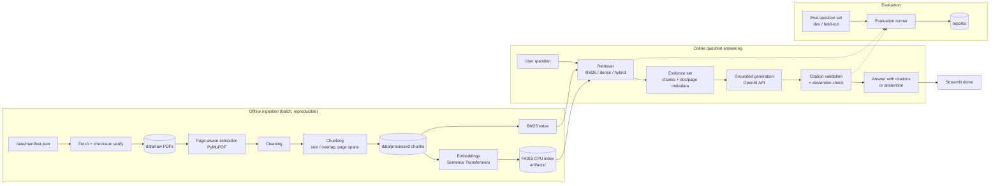
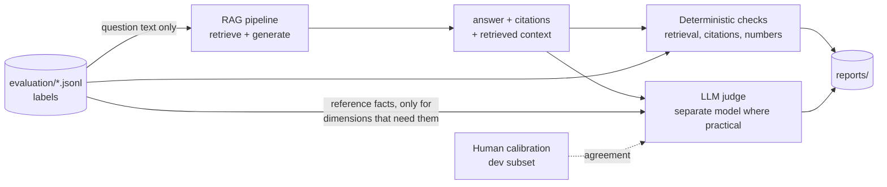

# Architecture

> **Status:** Stage 1 complete; Stage 2 (Commits 2.1–2.3) implemented;
> Stage 3 Commit 3.1 (BM25 baseline) implemented. Implemented:
> - `founderlens.config` and the `python -m founderlens` entry point;
> - `founderlens.corpus` (manifest, acquisition, integrity validation);
> - `founderlens.evaluation` (dataset schema and validation);
> - `founderlens.ingestion` (raw page-level extraction, normalization, table
>   candidates, page-aware chunking);
> - `founderlens.retrieval` (lexical tokenizer, in-memory BM25 baseline,
>   shared result type).
>
> Everything else below is the **planned** design and may change as
> evaluation results come in.

## Overview



## Offline ingestion pipeline (Stage 2)

1. **Manifest-driven fetch** *(implemented in Commit 1.2)*. `data/manifest.json`
   lists four official PDFs with provenance, SHA-256, size and page count.
   `founderlens.corpus.download` fetches over HTTPS from allowlisted hosts
   only, re-checks redirects, writes to a temporary file, verifies, then
   renames into `data/raw/` (git-ignored). `founderlens.corpus.validate`
   re-verifies hash, size, PDF signature, readability, encryption and page
   count, and is read-only.
2. **Page-aware extraction** *(implemented in Commit 2.1;
   [ingestion.md](ingestion.md))*. `founderlens.ingestion.extract`:
   - validates the corpus;
   - re-hashes each PDF and opens it from memory;
   - extracts every physical page with
     `Page.get_text("text", sort=True, flags=67)`;
   - writes one typed `PageRecord` per page (`page_id` =
     `{document_id}:p{NNNN}`) to `data/processed/pages.raw.jsonl`, atomically;
   - writes diagnostics to `reports/extraction_report.json`.

   The text is raw, not cleaned.
3. **Normalization and table candidates** *(implemented in Commit 2.2;
   [ingestion.md](ingestion.md#commit-22-layout-aware-normalization))*.
   `founderlens.ingestion.normalize`:
   - validates the corpus and the raw artifact, and rejects stale raw text by
     re-extracting each page;
   - applies conservative, idempotent text rules: LF, NFC, trailing
     whitespace, blank-line runs. Column padding is kept, and there is no
     dehyphenation or header/footer removal;
   - adds table candidates from word coordinates
     (`founderlens.ingestion.tables`), each `structured`, `uncertain` or
     `fallback`;
   - writes `data/processed/pages.normalized.jsonl`, keeping the text and
     the table view as separate fields.
4. **Chunking** *(implemented in Commit 2.3;
   [ingestion.md](ingestion.md#commit-23-page-aware-chunking))*.
   `founderlens.ingestion.chunk`:
   - validates the corpus and the normalized artifact against the manifest,
     with no PDF re-extraction;
   - splits each page's `normalized_text` into word windows. Size and overlap
     are configurable (default 120/24 whitespace words), and boundaries
     prefer paragraph, then line, then word breaks;
   - writes `data/processed/chunks.jsonl`. Each chunk is an exact
     `[start_char, end_char)` slice of one page, with a stable ID and a
     configuration ID;
   - validates coverage and overlap, and writes
     `reports/chunking_report.json`.

   Table candidates are not indexed. BM25 and dense retrieval share this one
   collection.
5. **Persisted output** in `data/processed/`, regenerable from raw inputs.

## Online question-answering pipeline (Stages 3–5)

1. **Retrieve** top-k chunks with BM25, dense search, or a hybrid.
2. **Assemble evidence** with document and page metadata.
3. **Generate** an answer constrained to the evidence.
4. **Validate citations**: each cited `(document, page)` must exist in the
   evidence set; unsupported claims trigger abstention or rejection.
5. **Abstain** when evidence is insufficient instead of guessing.

## Retrieval

### BM25 lexical baseline (implemented in Commit 3.1)

`founderlens.retrieval` is a transparent baseline over the chunk collection.
It is expected to be strong on exact financial terms, but no retrieval quality
has been measured yet; formal benchmarking is Commit 3.4.

**Modules.**
- `tokenize`: the shared lexical tokenizer.
- `schema`: `RetrievalResult` and validated `ChunkCollection` loading, both
  reusable by dense retrieval.
- `bm25`: `BM25Config`, `BM25Retriever` and the command-line interface.

**Library.** `rank-bm25==0.2.2` `BM25Okapi`, unmodified, with
`numpy==2.5.4`. Defaults are `k1 = 1.5`, `b = 0.75`, `epsilon = 0.25`,
`top_k = 5`.
- IDF is `ln((N − n + 0.5)/(n + 0.5))`. The library replaces negative values
  (terms in more than half of the chunks) with `epsilon × mean IDF`.
- A term in exactly half of the chunks has IDF 0.
- Document length is counted in lexical tokens, not ingestion words.
- `bm25_config_id` hashes the algorithm, library version, tokenizer version
  and scoring parameters. Index identity also needs the chunk artifact
  SHA-256; both are recorded.

**Tokenizer (version 1).** `str.casefold()`, then the regex
`[^\W_]+(?:[.,-][^\W_]+)*`: Unicode letter/digit runs, joined by a single
internal `.`, `,` or `-`. Everything else separates tokens.

| Text | Tokens |
|------|--------|
| `NVIDIA` | `nvidia` |
| `Blackwell` | `blackwell` |
| `FY2025` | `fy2025` |
| `Q4` | `q4` |
| `$39,331` | `39,331` |
| `37.5%` | `37.5` |
| `non-GAAP` | `non-gaap` |
| `Google Cloud` | `google`, `cloud` |
| `(146)` | `146` |
| `NVIDIA’s` | `nvidia`, `s` |

Dropping `$`, `%` or the parentheses of a negative value loses meaning in
the tokens. Results return the original chunk text, which keeps it.
- Numbers are not converted: `39,331` and `39331` do not match.
- There is no stemming, stop-word removal or synonym expansion.

**Index.** The validated `chunks.jsonl` is loaded and checked against the
manifest and the normalized pages:
- unique IDs and a single chunking configuration;
- manifest metadata;
- manifest, page and chunk order;
- exact source spans and full page coverage.

Only the original chunk text is indexed, with no metadata, labels or table
duplicates. The index is built in memory once per retriever and reused for
every query. A chunk with no lexical token would be left out and listed; on
corpus v1.0.0 all 162 chunks have tokens.

**Ranking.**
- A chunk **matches** when it contains a query token. Only matching chunks
  are returned, never padding.
- Matches are ranked by descending raw score. Matching is decided by token
  presence, not by score sign, so a match with a zero or negative score is
  still returned.
- Ties keep collection order (manifest document, page, chunk).
- At most `top_k` results are returned, fewer if fewer chunks match.
- There is no page deduplication before the cut, as in evaluation protocol
  v1.1.
- Empty, punctuation-only and fully out-of-vocabulary queries return no
  results. An empty result is not evidence that the corpus cannot answer.
- Scores are ranking scores, not probabilities. They are not normalized or
  thresholded, and they are not used for abstention.

**Command line.**

```powershell
python -m founderlens.retrieval.bm25 --query "NVIDIA Blackwell" --top-k 5
python -m founderlens.retrieval.bm25 --query "Google Cloud" --json
python -m founderlens.retrieval.bm25 --smoke   # reports/bm25_smoke_report.json
```

Also: `--chunks`, `--k1`, `--b`, `--epsilon`, `--project-root`. Invalid
parameters exit `2`; a missing or invalid collection exits `1`.

**Smoke run (corpus v1.0.0).** Exploratory queries written for the smoke
test, not evaluation questions. Index facts:
- 162 of 162 chunks indexed;
- vocabulary of 2,577 tokens;
- 17–127 lexical tokens per chunk (mean 95.7);
- index built in about 8 ms; one query takes about 0.1–0.25 ms (machine
  dependent).

Query observations:
- `NVIDIA Blackwell`: NVIDIA chunks only.
- `Google Cloud` and `free cash flow`: Alphabet segment and cash-flow pages
  first.
- `Google Cloud`: the Q3 and Q4 page-7 chunks tie exactly (6.9098), and
  collection order puts Q3 first.
- `fourth quarter fiscal 2025`: an NVIDIA Q3 chunk ranks first, because the
  Q3 release discusses its fourth-quarter outlook. This is a lexical
  limitation, not an error.
- `zyzzyva quokka` and `$ % ( ) -`: no results.

These observations show the retriever works. They are not relevance
judgements.

**Known limitations.**
- Lexical matching only: no paraphrase or synonym handling, and number
  formats must match exactly.
- Common words (`operating`, `income`, `2024`) get low or floored IDF, and
  query stop words add small noise.
- Period and company context outside a chunk's own text (e.g. a table header
  in an earlier chunk) is invisible to BM25.

**Requirements for Commit 3.2 (dense retrieval).** Not implemented yet. The
120-word budget does not guarantee compatibility with the planned
`sentence-transformers/all-MiniLM-L6-v2`, so Commit 3.2 must:
- audit every chunk's length with the model's actual tokenizer, special
  tokens and any input prefix included, and truncation disabled;
- inspect the model's effective maximum sequence length (`max_seq_length`
  and the tokenizer limit), not assume it;
- never truncate text silently;
- if a new chunk configuration is needed, keep the original collection and
  artifacts and build a separately identified one;
- evaluate BM25 and dense retrieval on the same collection, rebuilding BM25
  on any new one;
- check that the embedding dependencies are compatible with the pinned
  `numpy==2.5.4`, and change the pin only deliberately;
- pin the embedding model revision (commit hash) for reproducibility.

- **Dense retrieval (Stage 3).** Sentence Transformers embeddings with a FAISS
  CPU index (exact inner-product search is sufficient at this corpus size).
  Handles paraphrase and semantic queries BM25 misses.
- **Hybrid (optional).** Score or rank fusion, adopted only if evaluation
  shows a measurable gain.

## Generation and citation interfaces (planned, Stage 4)

Indicative contracts, not yet implemented:

- `retrieve(question, k) -> list[RetrievedChunk]` — chunk text, score,
  `document_id`, `page_start`, `page_end`.
- `answer(question, evidence) -> GroundedAnswer` — answer text, list of
  citations `(document_id, page)`, `abstained: bool`, token usage, latency.

The OpenAI client is the only external service and is injected so tests can
substitute a fake.

## Evaluation workflow

**Implemented (Commit 1.2):** `evaluation/questions.{dev,test}.jsonl`, 40
questions in five categories, reviewed by the project owner and frozen at
dataset v1.0.0, with fact-level page evidence. Their
hashes are recorded in `evaluation/dataset.json`, and
`founderlens.evaluation.validate` checks structure, distribution, evidence
references and file integrity.

**Planned (Stage 6):** a hybrid harness, specified in
[`evaluation_protocol.md`](evaluation_protocol.md):

1. deterministic retrieval metrics (page-level Recall@k, MRR, fact coverage);
2. deterministic citation validation;
3. reference-based answer checks (numeric parsing against required facts);
4. LLM-as-a-Judge, with one call and schema per dimension: faithfulness,
   correctness, relevance, completeness, citation support, abstention;
5. human calibration of the judge on predefined development items;
6. operational metrics (latency, tokens, cost).



**Isolation boundary.** The pipeline receives only the question text. Labels,
reference answers and evidence never reach retrieval, generation or an index.
The judge receives references only for correctness and abstention; it judges
faithfulness against the retrieved context. Evaluated text is treated as
untrusted data, and malformed judge output is recorded as an error, never a
pass.

## Module boundaries

| Module (planned) | Responsibility | Depends on |
|------------------|----------------|------------|
| `config` *(implemented)* | Project root and path resolution | stdlib |
| `corpus` *(implemented)* | Manifest, verified acquisition, integrity validation | config, stdlib `urllib`, PyMuPDF (validity and page counts) |
| `evaluation` *(schema and validation implemented)* | Dataset schema and validation; metrics, runner and judge planned | config, corpus manifest |
| `ingestion` *(implemented)* | Extract, normalize and table candidates, page-aware chunking | config, corpus, PyMuPDF |
| `retrieval` *(BM25 implemented)* | Lexical tokenizer, BM25 baseline, result type (done); dense, FAISS index | config, ingestion chunks, rank-bm25, NumPy |
| `generation` | Prompting, OpenAI calls, citations, abstention | retrieval types |
| `evaluation` | Metrics, runner, reports | retrieval, generation |
| `app` | Streamlit UI | generation |

Dependencies point one way (ingestion → retrieval → generation → evaluation/app).
Modules are created only in the stage that needs them.

## Data flow and storage

| Location | Contents | Tracked in git |
|----------|----------|----------------|
| `data/manifest.json` | Corpus definition (v1.0.0) | Yes |
| `evaluation/` | Questions, metadata and hashes | Yes |
| `data/raw/` | Downloaded PDFs | No |
| `data/processed/` | `pages.raw.jsonl` (raw page text), `pages.normalized.jsonl` (normalized text + table candidates), `chunks.jsonl` (retrieval chunks) | No |
| `artifacts/` | Indexes, embeddings | No |
| `reports/` | Extraction, normalization and chunking reports, BM25 smoke report, evaluation outputs | No (summaries copied to docs when verified) |

## Design decisions and trade-offs

- **Fixed corpus, no uploads.** Enables reproducible evaluation and removes
  multi-tenant and security surface area; limits generality.
- **No database.** Files + FAISS are sufficient at this scale and keep setup
  to `pip install`; would not scale to large or frequently changing corpora.
- **No orchestration framework** (LangChain/LangGraph). The pipeline is
  short; plain functions are easier to test, type-check and explain.
- **FAISS CPU, exact search.** No GPU requirement; approximate indexes are
  unnecessary for a small corpus.
- **BM25 first.** A strong, interpretable baseline makes dense-retrieval gains
  measurable rather than assumed.
- **Stdlib configuration.** A frozen dataclass avoids a settings-library
  dependency; revisit only if configuration grows substantially.
- **Stdlib downloader.** `urllib` with an explicit host allowlist and redirect
  checks avoids an HTTP-client dependency for four files.
- **PyMuPDF pinned at 1.28.2.** The 2.x line pulls in onnxruntime, numpy and
  networkx unconditionally. 1.28.x has no transitive dependencies. Its AGPL
  license must be resolved before public deployment (see README).
- **Metadata, not documents, in git.** The PDFs are fetched from official
  sources and verified by SHA-256 rather than redistributed.
