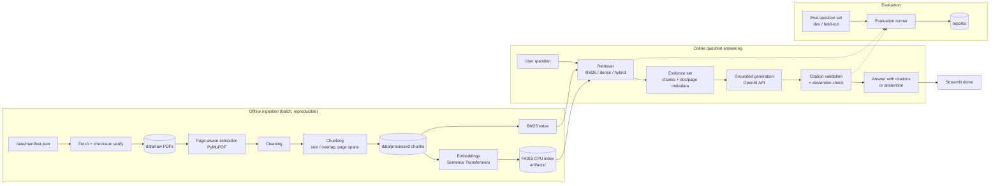

# Architecture

> **Status:** Stage 1. Only `founderlens.config` and the `python -m founderlens`
> entry point exist. Everything else below is the **planned** design and may
> change as evaluation results come in.

## Overview

## Offline ingestion pipeline (Stage 2)

1. **Manifest-driven fetch.** A fixed list of public PDFs with source URL and
   SHA-256 checksum. Files land in `data/raw/` (git-ignored).
2. **Page-aware extraction.** Text extracted per page so every downstream unit
   keeps `(document_id, page_number)`.
3. **Cleaning.** Normalize whitespace, de-hyphenate line breaks, strip repeated
   headers/footers where detectable. Cleaning must be deterministic.
4. **Chunking.** Configurable size and overlap; each chunk records its
   document and page span so citations can be checked.
5. **Persisted output** in `data/processed/`, regenerable from raw inputs.

## Online question-answering pipeline (Stages 3–5)

1. **Retrieve** top-k chunks with BM25, dense search, or a hybrid.
2. **Assemble evidence** with document and page metadata.
3. **Generate** an answer constrained to the evidence.
4. **Validate citations**: each cited `(document, page)` must exist in the
   evidence set; unsupported claims trigger abstention or rejection.
5. **Abstain** when evidence is insufficient instead of guessing.

## Retrieval

- **BM25 baseline (Stage 3).** Cheap, transparent, strong on exact financial
  terms (tickers, line items, fiscal years). It is the baseline every other
  method must beat on the development split.
- **Dense retrieval (Stage 3).** Sentence Transformers embeddings with a FAISS
  CPU index (exact inner-product search is sufficient at this corpus size).
  Handles paraphrase and semantic queries BM25 misses.
- **Hybrid (optional).** Score or rank fusion, adopted only if evaluation
  shows a measurable gain.

## Generation and citation interfaces (planned, Stage 4)

Indicative contracts, not yet implemented:

- `retrieve(question, k) -> list[RetrievedChunk]` — chunk text, score,
  `document_id`, `page_start`, `page_end`.
- `answer(question, evidence) -> GroundedAnswer` — answer text, list of
  citations `(document_id, page)`, `abstained: bool`, token usage, latency.

The OpenAI client is the only external service and is injected so tests can
substitute a fake.

## Evaluation workflow (Stage 6)

Question set (single-document, cross-document, unanswerable) split into
development and held-out sets → run retrieval and generation → score with the
metrics in `evaluation_protocol.md` → write versioned reports to `reports/`.

## Module boundaries

| Module (planned) | Responsibility | Depends on |
|------------------|----------------|------------|
| `config` *(implemented)* | Project root and path resolution | stdlib |
| `ingestion` | Fetch, extract, clean, chunk | config, PyMuPDF |
| `retrieval` | BM25, dense, FAISS index | config, chunks |
| `generation` | Prompting, OpenAI calls, citations, abstention | retrieval types |
| `evaluation` | Metrics, runner, reports | retrieval, generation |
| `app` | Streamlit UI | generation |

Dependencies point one way (ingestion → retrieval → generation → evaluation/app).
Modules are created only in the stage that needs them.

## Data flow and storage

| Location | Contents | Tracked in git |
|----------|----------|----------------|
| `data/manifest.json` | Corpus definition | Yes (Commit 1.2) |
| `data/raw/` | Downloaded PDFs | No |
| `data/processed/` | Extracted/chunked text | No |
| `artifacts/` | Indexes, embeddings | No |
| `reports/` | Evaluation outputs | No (summaries copied to docs when verified) |

## Design decisions and trade-offs

- **Fixed corpus, no uploads.** Enables reproducible evaluation and removes
  multi-tenant and security surface area; limits generality.
- **No database.** Files + FAISS are sufficient at this scale and keep setup
  to `pip install`; would not scale to large or frequently changing corpora.
- **No orchestration framework** (LangChain/LangGraph). The pipeline is
  short; plain functions are easier to test, type-check and explain.
- **FAISS CPU, exact search.** No GPU requirement; approximate indexes are
  unnecessary for a small corpus.
- **BM25 first.** A strong, interpretable baseline makes dense-retrieval gains
  measurable rather than assumed.
- **Stdlib configuration.** A frozen dataclass avoids a settings-library
  dependency; revisit only if configuration grows substantially.
