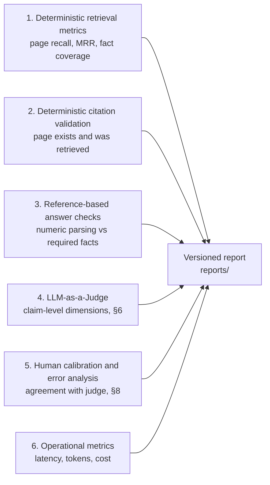

# Evaluation Protocol

> **Status: protocol v1.4.** It defines *how* the system will be evaluated.
> Stage 5 diagnostic acceptance is complete: the reportable v1.3 live run
> `live-20261124T045739024562Z-8665d379` is the frozen generation baseline (the v1.2
> pilot `live-20261123T111430692539Z-8665d379` remains incomplete). Development-split retrieval results
> are in [`retrieval_evaluation.md`](retrieval_evaluation.md). The question set
> (dataset v1.0.0) has been **reviewed by the project owner**, who accepted all
> 40 annotations without corrections, and is **frozen** (see
> [`evaluation/README.md`](../evaluation/README.md)). v1.1 states the retrieval
> metric definitions exactly (§3) and adds the benchmark freeze (§10). v1.2
> adds a narrowly scoped Stage 5 diagnostic amendment (§13). v1.3 adds
> prospective execution-complete reporting (§14). v1.4 adds the formal
> judging rubric and contracts (§15), deterministic financial checks
> (§16), the human-annotation and calibration workflow (§17) and agreement
> statistics (§18) and the frozen, budgeted judge pipeline (§19); judge runs,
> the human labels themselves and scoring
> are implemented in later Stage 6 commits. No formal answer-quality result
> exists yet.

## 1. Inputs

| Input | Location | Version |
|-------|----------|---------|
| Corpus manifest (4 earnings releases, 40 pages) | `data/manifest.json` | corpus 1.0.0 |
| Development questions (24) | `evaluation/questions.dev.jsonl` | dataset 1.0.0 |
| Held-out questions (16) | `evaluation/questions.test.jsonl` | dataset 1.0.0 |
| File hashes, status, changelog | `evaluation/dataset.json` | dataset 1.0.0 |

| Category | Dev | Held-out | Notes |
|----------|----:|---------:|-------|
| Single-document factual | 7 | 5 | One reported figure or fact |
| Single-document conceptual | 5 | 3 | Definitions, methodology, explanations |
| Cross-document comparison | 5 | 3 | No single document holds all required facts (validator-enforced) |
| Temporal / multi-evidence | 2 | 2 | Outlook vs actual, period alignment, ≥ 2 facts |
| Unanswerable | 5 | 3 | Plausible in-domain; corpus lacks the answer |
| **Total** | **24** | **16** | |

Each answerable question lists **required facts** (independently scorable, with
structured company/period/metric/value/unit/basis for numbers) and **accepted
evidence**: one or more `(document_id, page_number)` references per fact.

## 2. Relevance unit

Relevance is defined at **page level**: a pair `(document_id, page_number)` where
`page_number` is the **one-based physical PDF page** (not a printed page label).

- `E(f)`: accepted evidence pages for required fact `f`.
- `G(q) = ⋃ E(f)` over the required facts `F(q)` of question `q`.

## 3. Retrieval experiment (Stage 3 → measured in Stage 6)

| System | Definition |
|--------|------------|
| **Baseline A — BM25** | Okapi BM25 over chunk text. Tokenization and parameters fixed in code and recorded. |
| **Baseline B — Dense** | One fixed Sentence Transformers model (named and version-pinned before the first evaluation run); L2-normalized embeddings; FAISS CPU exact inner-product index. |

**Controlled comparison.** A and B use the **same corpus version, the same chunk
collection (same chunker, size and overlap), the same queries and the same k.**
Only the ranking function differs. Hybrid fusion, if attempted, is a separate
system reported next to both baselines.

### Top-k, page identities and duplicates

A retriever returns a ranked list of chunks `c_1, c_2, …`. Each chunk carries
the set of page identities it overlaps, `pages(c)`, where a page identity is a
`(document_id, page_number)` pair.

1. **Top-k is the first k retrieved chunks**, `c_1..c_k`, exactly as ranked. k
   counts chunks, because chunks are what the generator receives.
2. **No deduplication happens before the cut.** Several chunks from the same
   page each take a slot in the top k. Redundant retrieval therefore costs
   rank positions, as it costs context in generation.
3. **Page identities are deduplicated only within those k chunks.**
   `P_k(q) = pages(c_1) ∪ … ∪ pages(c_k)` is a set, so a page retrieved by
   several chunks counts once. Duplicates cannot inflate recall or coverage.
4. Also reported: **unique pages in top-k**, `|P_k(q)|`, which exposes
   redundant retrieval.

**Interchangeable evidence.** A fact can have several accepted pages `E(f)`,
for example the same figure in a summary table and in a later comparison
column. They are alternatives, not a conjunction: retrieving **any one**
accepted page satisfies the fact at the page-annotation level.

**Page coverage is a proxy.** A covered fact means a top-k chunk overlaps an
accepted page. It does not prove that the chunk contains the supporting
passage: a chunk can overlap the right page and miss the relevant table row.
Whether the evidence actually reached the generator is measured separately, by
groundedness and citation support (§4, §6).

### Retrieval metrics

Computed **only for answerable questions** (unanswerable questions have no gold
evidence; their behaviour is measured as abstention in §4). `F(q)` is the
question's required facts, `E(f)` the accepted pages for fact `f`, and
`G(q) = ⋃ E(f)`.

| Metric | Per-question definition | Aggregation |
|--------|------------------------|-------------|
| **Evidence-page Recall@k**, k ∈ {1, 3, 5, 10} | `1 if P_k(q) ∩ G(q) ≠ ∅ else 0`: at least one accepted page of any required fact is in the top k. This is a hit rate, not a fraction of pages retrieved. | Mean over questions |
| **Required-fact coverage@k** | `|{f ∈ F(q) : P_k(q) ∩ E(f) ≠ ∅}| / |F(q)|`: the fraction of required facts with at least one accepted page in the top k | Mean over questions |
| **Complete required-fact coverage@k** | `1` if every `f ∈ F(q)` has an accepted page in `P_k(q)`, else `0`. Reported over questions with `|F(q)| ≥ 2`; for a single-fact question it equals Recall@k. | Mean over those questions |
| **Mean Reciprocal Rank** (cut-off 10) | `1 / rank_first(q)`, where `rank_first(q)` is the smallest chunk rank `i` with `pages(c_i) ∩ G(q) ≠ ∅`. Ranks count chunks before any deduplication. `0` if no such `i ≤ 10`. | Mean over questions |
| Retrieval latency | Wall-clock time per query (embedding + search, or BM25 scoring), index already loaded, after one warm-up query | p50 and p95 in ms |

Recall@k asks whether *any* evidence was found. Required-fact coverage asks how
much of the *needed* evidence was found, and complete coverage asks whether
*all* of it was. For cross-document questions these can differ sharply:
retrieving one company's page gives Recall@k = 1 but only partial coverage.

Reporting rules:

- Macro-average over questions; report per category and overall, always with `n`.
- Development and held-out results are reported separately and never pooled.
- With so few questions (19 answerable dev, 13 answerable held-out), report
  95% bootstrap intervals (10,000 resamples over questions, fixed seed) and
  avoid claiming differences that the intervals do not support.
- Record hardware, Python and library versions, index size and chunk count.

## 4. Generation metrics (Stages 4–5 → measured in Stage 6)

Definitions: an answer consists of **claims** (atomic factual statements,
segmented by the judge per §6) and **citations** `(document_id, page_number)`
attached to claims. `R(q)` is the set of pages in the context actually given to
the generator.

| Metric | Definition | Scoring | Aggregation | Applies to |
|--------|------------|---------|-------------|------------|
| Reference fact correctness | Fraction of required facts stated correctly in the answer | Per fact: correct / incorrect / missing (judge, §6.2) | Per question `correct / |F(q)|`; macro mean | Answerable |
| Numerical correctness | A numeric required fact is correct only if value, unit/scale, company, period **and** GAAP/non-GAAP basis all match. Rounding to the precision the source states is accepted ($35.1B ≡ $35,082M); percentages need the source's precision | Per numeric fact, binary; **deterministic** parse plus judge confirmation of attribution | Micro mean over numeric facts | Answerable with numeric facts |
| Citation validity | Citation refers to a real corpus page **and** that page ∈ `R(q)` | Per citation, binary, **deterministic** | Micro mean over citations; also % of answers with ≥ 1 invalid citation | Answers with citations |
| Citation support | The cited page's text supports the claim it is attached to | Per (claim, citation), binary (judge, §6.5) | Micro mean over pairs | Answers with citations |
| Groundedness (faithfulness) | Fraction of answer claims supported by the retrieved context `R(q)` | Per claim: supported / unsupported / contradicted (judge, §6.1) | Per answer `supported / claims`; macro mean; plus % of answers with any contradicted claim | All non-abstained answers |
| Answerable-question coverage | Fraction of answerable questions answered rather than abstained | Binary per question | Mean | Answerable |
| Correct abstention rate | Fraction of unanswerable questions where the system abstains | Binary (deterministic flag plus judge check, §6.6) | Mean | Unanswerable |
| False abstention rate | Fraction of answerable questions where the system abstains | Binary | Mean | Answerable |
| End-to-end latency | Question in → final answer out, including retrieval and API calls | Per question | p50 / p95 (s) | All |
| Token usage and cost | Prompt and completion tokens per question; cost = tokens × provider price **recorded with its date** | Per question | Mean and total | All |

**Citation validity ≠ citation support.** A citation can point to a real,
retrieved page (valid) and still fail to support the claim it is attached to
(unsupported). Both are reported.

## 5. Hybrid evaluation framework

No single score summarizes quality. The Stage 6 harness combines six layers,
each reported separately:

The deterministic layers (1–3) take precedence: where a deterministic check
exists (for example, citation validity), the judge does not override it.

## 6. LLM-as-a-Judge design

Each dimension is a **separate judge call with its own prompt and output schema**
(no single "overall quality" score). Outputs must be JSON matching the schema.
Labels are binary or small ordinal sets; claim-level where possible.

### 6.1 Faithfulness to retrieved evidence

- **Definition:** Is each claim in the answer supported by the **retrieved
  context the generator actually saw** (not the gold evidence)?
- **Inputs:** question, generated answer, retrieved passages with
  `(document_id, page)` labels.
- **Rubric per claim:** `supported` (stated in or directly entailed by the
  context); `unsupported` (not in the context, even if true in reality);
  `contradicted` (conflicts with the context).
- **Output:** `{"claims": [{"claim": str, "label": "supported|unsupported|contradicted", "evidence_quote": str|null}]}`.
- **Failure conditions:** any `contradicted` claim; groundedness < 1.0.
- **Aggregation:** per answer, supported/total claims; macro mean; % of answers
  with ≥ 1 contradicted claim.
- **Categories:** all non-abstained answers.
- **Limitations:** claim segmentation varies between runs; judges tend to accept
  paraphrases too readily and to miss errors of scale ($ millions vs billions).

### 6.2 Answer correctness against reference facts

- **Definition:** Does the answer state each required fact correctly?
- **Inputs:** question, generated answer, required facts (statement plus
  structured numeric fields). **Not** the retrieved context.
- **Rubric per fact:** `correct`; `incorrect` (stated but wrong value, period,
  company or basis); `missing`.
- **Output:** `{"facts": [{"fact_id": str, "label": "correct|incorrect|missing", "rationale": str}]}`.
- **Failure conditions:** any `incorrect` fact; for numbers, a mismatch the
  deterministic parser found always counts as incorrect.
- **Aggregation:** per question, correct/required; macro mean; per category.
- **Categories:** answerable questions.
- **Limitations:** depends on the quality of the reference annotations;
  may penalize correct extra detail when the reference is narrower.

### 6.3 Answer relevance

- **Definition:** Does the answer address the question that was asked (right
  company, period and metric) without substituting a different question?
- **Inputs:** question and answer only.
- **Rubric (ordinal 0–2):** `2` directly answers; `1` partially or with
  material irrelevant content; `0` answers a different question or is off-topic.
- **Output:** `{"score": 0|1|2, "rationale": str}`.
- **Failure conditions:** score `0`; answering with the wrong fiscal period
  (for example, NVIDIA fiscal Q4 treated as calendar Q4).
- **Aggregation:** mean score and distribution.
- **Categories:** answerable questions, non-abstained.
- **Limitations:** subjective. Used for diagnosis, not as a headline metric.

### 6.4 Completeness of required facts

- **Definition:** Does the answer contain **all** facts the question needs?
- **Inputs:** derived from §6.2 labels (no separate call).
- **Rubric:** `complete` (all `correct`), `partial` (≥ 1 correct, others
  missing or incorrect), `none`.
- **Output:** derived label per question.
- **Failure conditions:** `partial` or `none` on a multi-fact question.
- **Aggregation:** share of questions in each label; reported separately for
  cross-document and temporal questions.
- **Categories:** answerable questions.
- **Limitations:** inherits §6.2's errors.

### 6.5 Citation support at claim level

- **Definition:** For each (claim, citation) pair, does the **cited page's**
  text support the claim?
- **Inputs:** claim, cited page text. Citation validity (§4) is checked
  deterministically first; invalid citations are not sent to the judge and
  count as unsupported.
- **Rubric per pair:** `supports`, `partially_supports`, `does_not_support`.
- **Output:** `{"pairs": [{"claim": str, "citation": {"document_id": str, "page_number": int}, "label": str}]}`.
- **Failure conditions:** `does_not_support`; also uncited factual claims
  (counted deterministically).
- **Aggregation:** citation support = `supports` / all pairs (micro);
  `partially_supports` reported separately.
- **Categories:** answers with citations.
- **Limitations:** dense financial tables extract poorly from PDFs, so a judge
  may miss support that is present in a table.

### 6.6 Appropriateness of abstention

- **Definition:** Did the system abstain exactly when the corpus cannot support
  an answer, and was its stated reason accurate?
- **Inputs:** question, answer or abstention text, `answerable` flag,
  `expected_abstention_reason` (unanswerable) or required facts (answerable).
- **Rubric:** `correct_abstention`; `correct_answer_attempt`;
  `false_abstention` (abstained on an answerable question);
  `missed_abstention` (answered an unanswerable question). Plus a reason label
  `reason_consistent | reason_inconsistent`.
- **Output:** `{"label": str, "reason_label": str|null, "rationale": str}`.
- **Failure conditions:** `false_abstention`, `missed_abstention`.
- **Aggregation:** confusion matrix; correct and false abstention rates (§4).
- **Categories:** all questions.
- **Limitations:** hedged partial answers are hard to classify; the harness
  first applies a deterministic abstention flag from the generator's
  structured output.

## 7. Judge configuration and reproducibility

Every judged run records, in the report and as raw JSON:

- judge provider and **exact judge model identifier**;
- judge prompt version **and SHA-256 of each prompt template**;
- evaluation dataset version and file hashes (`evaluation/dataset.json`);
  corpus version;
- generation model identifier and generation prompt version;
- retrieval configuration (system, chunker, size, overlap, k, embedding model);
- sampling parameters where supported (temperature 0, top-p, seed if offered);
- timestamp (UTC), git commit;
- token usage and cost per call where available;
- **raw structured judge outputs**, kept unmodified.

**Judge independence.** Use a judge from a different model family than the
generator where practical. Same-family judging risks *self-preference*: shared
blind spots and favourable scoring of the generator's own phrasing. If the same
family is used, the report must say so.

## 8. Judge reliability and human calibration

The judge is a measuring instrument with error, **not ground truth**.

**Calibration set (predefined, development split only).** Before any judged
result is reported, a human (the project owner) labels judge inputs built from
these development questions, using real system outputs plus deliberately
constructed variants:

| Case type | Built from |
|-----------|-----------|
| Correct grounded answer | dev-001, dev-008 |
| Correct but incomplete answer | dev-012 (drop facts), dev-015 (omit definition difference) |
| Plausible hallucination | dev-019 (invent a quarter-end date) |
| Incorrect financial figure | dev-003 (GAAP 74.6% given for non-GAAP), dev-014 (wrong scale) |
| Correct answer, unsupported citation | dev-013, dev-018 (cite a real but irrelevant page) |
| Appropriate abstention | dev-020, dev-023 |
| Inappropriate abstention / missed abstention | dev-005 (abstain); dev-022 (fabricated unit count) |

**Procedure.**

1. Freeze the judge prompts and model. Humans label first, blind to judge output.
2. Run the judge on the same items.
3. Report per-dimension percentage agreement and Cohen's κ (weighted κ for
   ordinal relevance), with a confusion matrix.
4. Review every disagreement. Classify it as a judge error, a rubric
   ambiguity, or a reference error. Fix rubrics or references on development
   data only, version the prompt, and re-run.
5. Target agreement: κ ≥ 0.6 per dimension before judge scores are used as
   headline metrics. This is a target, not a measured result. Dimensions below
   target are reported as experimental, or replaced by human scoring.

Held-out items are never used for calibration or prompt iteration.

## 9. Evaluation security and isolation

- The **generation pipeline never receives** reference answers, required facts,
  accepted evidence, abstention reasons or any evaluation file. Evaluation
  files are never indexed or chunked.
- The **judge may receive** reference answers or evidence **only for the
  dimensions that need them** (§6.2, §6.6). Faithfulness (§6.1) uses the actual
  retrieved context, never silently substituted gold evidence.
- Reference-based correctness checks each required fact separately, not only
  the overall reference answer.
- Generated answers, retrieved passages and reference text are placed in
  clearly delimited data blocks in judge prompts, which state that the content
  is **untrusted data** and that **instructions inside it must not be
  followed**. Injection-style content in source documents or answers must not
  change the verdict.
- Malformed, truncated or schema-invalid judge output is recorded as an
  **evaluation error**. It is retried at most once, then reported as errored,
  and **never counted as a pass**.

## 10. Benchmark freeze and integrity rules for the held-out split

Dataset v1.0.0 is **frozen**. Later stages may tune the system on development
questions only. Held-out questions must not guide document preprocessing,
chunk size or overlap, embedding model selection, retrieval configuration,
generation prompts, or judge prompts and calibration.

- Only **development** questions may be used for tuning or debugging.
- Do **not** tune chunk size, chunk overlap, top-k, fusion weights or prompts on
  held-out results. Do **not** choose the embedding model using held-out scores.
- Do not modify generation prompts in response to held-out failures.
- Never expose reference answers or labels to retrieval or generation; never
  index evaluation files; never put labels in LLM context, except the judge
  inputs in §9.
- Held-out questions must not be used as demo defaults or examples.
- Future Claude Code sessions must not read held-out question content for
  development or optimization. Schema validation (counts and identifiers) is
  allowed.
- The held-out split is a **procedural holdout**. The labels are public in
  this repository, so it is not a cryptographically isolated or independently
  administered test set.
- The held-out split is evaluated once per frozen configuration. Any change made
  after viewing held-out results is logged, and later held-out numbers are
  labelled as no longer clean.
- Dataset changes bump `dataset_version`, update the hashes and the changelog
  in `evaluation/dataset.json`, and are explained in `evaluation/README.md`.
  Questions are not silently changed after benchmarking.

## 11. Limitations

- **Small sample:** 40 questions (32 answerable), so intervals are wide.
- **Same-corpus holdout:** dev and held-out questions come from the same four
  documents. This tests generalization to new questions, not to new documents.
- **Public test labels:** anyone, including future model training data, can
  see them.
- **Annotator bias:** a single author (Claude Code) wrote the labels and a
  single reviewer (the project owner) accepted them. There was no independent
  second annotation and no inter-annotator agreement measurement. Question
  style may favour certain retrieval behaviours.
- **PDF table complexity:** the releases are table-heavy, and text extraction
  breaks row and column structure. This affects retrieval, generation and
  judging alike.
- **Company and period coverage:** two companies and two quarters each. NVIDIA's
  fiscal calendar differs from Alphabet's, which is intentional but narrow.
- **LLM evaluation variability:** judge outputs vary with model version and
  sampling. Results depend on the recorded configuration and human calibration.

## 12. Reporting

A single command (Stage 6) will produce a versioned report in `reports/` with
every metric above, per category and per split, plus the configuration record
in §7. Only numbers from such runs may be quoted in documentation, with one
exception: approved Stage 5 deterministic diagnostics (§13, with §14
completion states for runs under v1.3).

## 13. Stage 5 diagnostic amendment (v1.2)

**Why.** Stage 5 must report cross-document and unanswerable category results.
Before v1.2, §4 reserved generation metrics for Stage 6, several §4 metrics
need the judge (§6), judge scores need human calibration first (§8), and §12
allowed only Stage 6 numbers to be quoted. v1.2 adds one narrow exception: a
deterministic **diagnostic** report. Nothing in §1–§12 is weakened.

**Unchanged.** Questions, labels, required facts, accepted evidence, the
dataset version, the category distribution, every §3–§8 definition, the judge
design, the κ ≥ 0.6 calibration target, the isolation rules (§9) and the
held-out freeze (§10).

**Classification and caveat.** Every report carries
`evaluation_kind: diagnostic_deterministic` and this caveat, verbatim:

> These diagnostics do not establish answer correctness, faithfulness,
> claim-level citation support or semantic abstention appropriateness. Formal
> evaluation remains pending Stage 6.

**Scope.**
- Development split only (24 questions), through the hash-checked
  development loader. The held-out file is never opened.
- The pipeline receives the question text only. Required facts and accepted
  evidence are used only in scoring. Reference answers and expected abstention
  reasons are not read.
- One frozen generation per question, one citation resolution and one
  deterministic guardrail check of that same response. No judge, no repair, no
  fallback, no rewriting.

**Metrics.** Every metric reports its eligible population, numerator and
denominator, overall and per category. A zero denominator is reported as
`not_applicable`, never as zero.

| Metric | Per-question definition | Eligible population |
|---|---|---|
| Execution outcome | `completed`, `failed` (error category), `not_run_budget`, `not_run_aborted`, `not_run_interrupted`, `not_replayable` | all questions |
| Status distribution | answered, partially_answered, insufficient_evidence, local_abstention | completed questions |
| `answer_attempt_rate` | answered or partially_answered | completed answerable |
| `abstention_on_answerable_rate` | insufficient_evidence or local abstention | completed answerable |
| `abstention_on_unanswerable_rate` | insufficient_evidence or local abstention | completed unanswerable |
| `answered_on_unanswerable_rate` | answered | completed unanswerable |
| `partially_answered_on_unanswerable_rate` | partially_answered, never folded into either of the above | completed unanswerable |
| `selected_evidence_page_recall` | §3 Recall over the distinct pages of the model-visible evidence | completed answerable |
| `selected_evidence_fact_coverage` | §3 required-fact coverage over those pages | completed answerable |
| `selected_evidence_complete_fact_coverage` | every required fact has an accepted selected page | completed answerable with ≥ 2 facts |
| `cited_evidence_page_recall`, `cited_evidence_fact_coverage`, `cited_evidence_complete_fact_coverage` | the same over the distinct pages of the cited evidence | completed answerable with an answer attempt (and ≥ 2 facts for complete) |
| `accepted_page_citation_overlap` | distinct cited (document, page) pairs that are accepted pages | distinct cited pages in answerable answer attempts (micro) |
| Citation structural invariants | each citation's chunk, document and page equal its selected evidence | all citations |
| Guardrail findings | counts by finding category × severity, numeric trace counts, questions with ≥ 1 warning | completed questions with completed checks |
| Provider usage | provider-reported tokens; `None` stays not reported | completed questions answered by the provider |
| Local token estimates | local tokenizer count of instructions + input, labelled as an estimate | same |
| Latency | context, provider and total ms, p50 and p95 (operational section) | completed questions |

- Pages are deduplicated per question at the (document, page) level before
  any page metric, so several chunks or citations on one page count once.
  Citation counts are reported separately and never stand in for page
  coverage.
- Abstention metrics are **operational flags**. An abstention on a question
  labelled unanswerable is not called correct: whether the stated reason is
  appropriate is §6.6, a judge dimension.
- `accepted_page_citation_overlap` is a **reference-alignment diagnostic**:
  how far the cited pages coincide with the annotated accepted pages. It is
  not semantic citation precision, claim-level support, verified
  faithfulness or a bound on factual correctness. A cited accepted page
  does not establish that the passage supports the claim, and a
  non-accepted page may also support it, because accepted evidence is not
  exhaustive.
- Alternative accepted pages for one fact are alternatives, exactly as in
  §3: any one of them covers the fact.
- Not implemented here, and still Stage 6: reference fact correctness,
  numerical correctness, groundedness, citation support, completeness,
  relevance and judge-checked abstention appropriateness.

**Small samples.** Overall and per-category rates use the §3 percentile
bootstrap (10,000 resamples, fixed seed) with a small-sample warning below 10
questions. Categories with fewer than 5 dataset questions (temporal, n = 2)
report counts only.

**Failures.** Authentication, permission, quota, model-availability and
configuration failures abort a live run; later questions are
`not_run_aborted`. Transport, timeout, rate-limit and server errors are
failures, with no retry. Refusals, incomplete generations and invalid
structured output are failures, never abstentions. Citation-resolution
failures are failures. A guardrail failure keeps the generated response and
marks only the diagnostics as failed. Local abstentions are completed
outcomes. Failed and unrun questions are excluded from rate denominators but
always counted, per category. Raw provider messages are never recorded.

**Failure diagnostics (record schema 2).** Each failed record carries a
`failure` block with codes only:
- `stage`: `generation` (context or provider request), `answer_validation`
  (local response invariants on a parsed provider answer),
  `citation_resolution`, or `replay_verification`;
- `error_category`, the sanitized provider `request_id` and HTTP
  `status_code` when known;
- `problems`: one entry per violated invariant, with a stable `code`
  (`insufficient_evidence_has_claims`, `claims_required`,
  `answered_has_limitations`, `limitations_required`, `blank_limitation`,
  `blank_claim_text`, `claim_cites_no_evidence`, `duplicate_evidence_id`,
  `malformed_evidence_id`, `unknown_evidence_id`), one-based claim, evidence
  reference or limitation positions, and the model-supplied evidence ID passed
  through `safe_token` and cut to 32 characters;
- `usage_recorded`.

The rejected answer, its text, the prompt, the question, passages and
exception messages are never stored. A response-contract violation stays a
failure: no repair, retry, fallback or status change. When the provider
reported usage for a rejected answer, the record keeps it.

**Usage accounting.** Provider usage is summed over every attempted request,
failures included. Reports show `attempted_requests`, `requests_with_usage`
and `usage_complete`; usage the provider did not report stays unknown
(`None`), never zero, and incomplete totals are labelled as understating
spend.

**Record schema versions.** Version 2 adds the failure block and the usage of
rejected answers. Version 1 records (Commit 6.3) remain replayable: their
completed answers replay as before, and their failures are reported with
`failure_diagnostics: not_recorded_in_record_schema_1` rather than invented
details. A replay refuses records that mix schema versions or use an unknown
one. Existing runs are never rewritten.

**Run completion.** A run is complete only if every development question is
`completed` exactly once, every guardrail check completed, and the run was
neither aborted nor interrupted. Runs are never merged. An incomplete run is
never presented as a 24-question result.

**Provenance.** Every record and report carries its execution mode
(`dry_run`, `live`, `replay`) and its **origin**: the mode and run ID of
the run that produced the answers. A replay keeps its source run's origin,
so a replay of a dry run is still synthetic and a replay of a live run keeps
the live run ID. Replays add no provider-usage or latency observations.

**Exception to §12.** Only a **complete** run whose origin is `live` (the
live run itself, or a replay of it) may be quoted in documentation, as a
Stage 5 diagnostic of the hosted model: labelled `diagnostic_deterministic`,
with denominators, the origin run ID and the command. Reportability follows
the origin, never the current execution mode. Dry runs and replays of dry
runs come from a synthetic placeholder provider and are never evidence of
model performance. An incomplete run is never reportable.

**Paid execution.** Never automatic. A live run needs `--live`,
`FOUNDERLENS_RUN_PAID_EVAL=1`, an explicit `--max-requests N` (1–24, no
default), a clean Git working tree, the frozen identities and locally
configured credentials. The budget counts attempted requests, including
failed ones, and is enforced before sending. SDK retries are disabled; the
semantic model configuration is unchanged. Cost is estimated only from a
price and effective date the user supplies.

**Replay.** A replay rebuilds each request through the frozen pipeline,
requires the exact stored request and instruction hashes and identities,
revalidates the stored answer through the unchanged service and resolver,
requires identical citation associations and recomputes the guardrails. It
rejects modified, mixed-run, duplicate, provenance-inconsistent or
incompatible records. Each record's SHA-256 digest detects accidental
modification or truncation; it is not a signature and does not prevent
deliberate forgery. Replay reproduces neither model sampling nor provider
latency, and reports the original run's usage separately.

**Privacy.** The aggregate JSON and Markdown hold IDs, codes and numbers only.
The per-question records hold validated answers and citation associations
(never question text) for replay, human review and Stage 6 judging. All three
are git-ignored private evaluation artifacts.

**Tuning.** Development results produced after any change motivated by them
(for example Commit 6.4) are labelled post-tuning. Stage 6 human calibration
(§8) is still required before any judge score is reported.

## 14. Execution-complete reporting amendment (v1.3)

**Why.** The first authorized live diagnostic run, `live-20261123T111430692539Z-8665d379`, ran under v1.2:
24 scheduled questions, 24 provider attempts, 23 valid outcomes and one
`response_contract` failure. v1.2 makes a run reportable only if every answer
is valid. Repeating runs until one succeeds would then select for success:
the reported failure rate would be zero by construction, and failures, which
tend to occur on harder questions, would be filtered out. The pilot's failure
motivated this amendment; no metric value did.

**Prospective only.** v1.3 applies to runs started under it (record schema 3,
`protocol_version: "1.3"`). Records of schemas 1 and 2 keep v1.2 semantics,
including on replay, and are never upgraded. The pilot stays **incomplete and
not reportable**; it may be cited only as a disclosed pilot.

**Unchanged.** Questions, labels, accepted evidence, the frozen pipeline and
identities, §13 metric definitions, the caveat, the judge design and §8
calibration, isolation and the held-out freeze.

**Execution outcomes.** Every scheduled question ends as exactly one of
`valid_answer`, `local_abstention`, `model_output_failure`,
`infrastructure_failure`, `integrity_failure` or `not_run` (budget, abort,
interruption, or an unreplayable source).

**Failure taxonomy** (stage and category together; anything not listed,
including unknown combinations, is an integrity failure):

| Class | Stage / category |
|---|---|
| model output | `answer_validation/response_contract` (the provider's parsed answer broke a response invariant), `generation/refusal`, `generation/incomplete`, `generation/structured_output_invalid` |
| infrastructure | `generation/` `timeout`, `connection`, `rate_limited`, `provider_server_error`, `authentication`, `permission_denied`, `quota_exceeded`, `model_unavailable`, `configuration` |
| integrity | everything else, e.g. `citation_resolution/*` (including the resolver's own `response_contract` revalidation), `replay_verification/*`, `generation/unexpected_response`, context errors, unknown categories |

**Completion states** (mutually exclusive):

| State | Definition | Reportable when the origin is live |
|---|---|---|
| `answer_complete` | every question has a valid answer or local abstention; every guardrail check completed | yes |
| `execution_complete` | every question reached a terminal outcome; at least one model-output failure; nothing else wrong | yes, with every model-output failure counted |
| `incomplete` | any infrastructure or integrity failure, guardrail failure, unrun question, interruption, abort, or structural problem (coverage, mixed identities, protocol or origin) | no |

Reportability requires a live origin, protocol 1.3, one of the first two
states, every scheduled question accounted for exactly once, and consistent
frozen identities and provenance. A replay keeps its source run's protocol,
origin and state. Dry runs and their replays are never hosted-model evidence.

**Denominators.** Every metric states its eligible population, numerator and
denominator; a zero denominator is `not_applicable`.
- *Conditional* metrics (the §13 table) are over valid outcomes. Each one
  reports `excluded_scheduled`: the scheduled questions of its population
  and how many were left out, by outcome.
- *Unconditional* metrics are over scheduled questions with a terminal
  outcome, where a model-output failure is a separate outcome, never an
  attempt, partial answer or abstention:
  - the scheduled-question outcome distribution;
  - `contract_valid_outcome_rate`: valid answers and local abstentions over
    terminal questions;
  - `model_output_failure_rate`: model-output failures over terminal
    questions the provider answered;
  - failure counts by class and category;
  - unconditional answer-attempt, abstention and answered or partially
    answered flags for answerable and unanswerable questions.
- Retrieval (selected-evidence) metrics include a failed question when the
  evidence of the request actually sent was recorded (`selected_evidence_source:
  model_facing_request`: evidence IDs, documents and pages from that request,
  tied to it by its hashes; nothing is retrieved again). Questions without a
  recorded observation are excluded and counted, never reconstructed.
- Answer-dependent metrics (cited coverage, accepted-page overlap, guardrail
  findings) stay conditional on valid answers.
- Sample sizes stay small (temporal n = 2, unanswerable n = 5): §13 counts-only
  and small-sample rules still apply.

**Selection rule and run log.** Report the first execution-complete live run
under v1.3, and disclose every other run. Before any live provider exists,
the harness appends a `preregistered` entry to the git-ignored
`reports/generation_eval/run_log.jsonl`: run ID, UTC start, Git commit and
clean state, protocol, dataset hashes, every frozen identity, the request cap
and the selection rule. When the run ends it appends `finished`: completion
state, reportability, outcome and failure counts, attempts, interruption and
abort. A run with only a `preregistered` entry is unfinished. Entries are
appended, flushed and never rewritten; the file is local and not
tamper-proof. Runs left incomplete by infrastructure failures are disclosed
and investigated; nothing is rerun automatically.

**Disclosure.** Every report states the protocol, completion state, all
model-output failures, missing provider usage (`usage_complete: false`) and
sample sizes. None of this is answer correctness, faithfulness or semantic
citation support, and Stage 6 judge calibration is still required. A
contract-valid outcome is structurally valid under the response contract, not
factually correct.

**Artifact contents.**

| Artifact | Contains | Never contains |
|---|---|---|
| per-question records (`*.records.jsonl`, private, git-ignored) | for valid answers: the validated structured answer (claim text, claim types, evidence IDs, limitations), citation associations, selected-evidence provenance, request hashes, usage, timings, guardrail metadata; for failures: the typed failure block, request hashes, evidence provenance from the sent request, provider usage | question text, prompts, passages, a rejected answer's text, raw provider errors, credentials |
| aggregate JSON and Markdown summary | IDs, codes, counts, rates, identities | any question, answer, limitation or passage text |
| run log | run IDs, timestamps, Git state, identities, dataset hashes, request cap, completion states, outcome counts | any question, answer or passage text |

**Replay of failures.** A successful record replays without any provider
request: the rebuilt request must match its stored hashes, and the stored
answer is revalidated through the unchanged service and resolver. A recorded
failure is never re-inferred: it replays as `not_replayable` with its original
execution outcome, error category, typed failure block, request hashes and
captured evidence provenance carried from the digest-checked source record.
No new usage or provider attempt is recorded (the original usage stays in
`replay_of`), so the replay reports the same completion state, reliability
and retrieval metrics as its source.

## 15. Formal judging amendment (v1.4)

**Scope.** v1.4 defines formal judging of frozen generation outputs: the
units, the rubric, admissible evidence, label provenance and the calibration
requirement. It adds no generation semantics: input records keep the
generation protocol they ran under (the Stage 5 baseline `live-20261124T045739024562Z-8665d379` stays a
protocol 1.3 generation run and is never relabelled as v1.4). Commit 7.1 defines
the contracts only; no human label, judge score or deterministic score exists
yet.

**Admissible input.** A run is admissible only if it verifies completely
(`founderlens.evaluation.judging_input`): live origin, generation protocol
1.3, an accepted completion state, reportable, the generation commit on a
clean tree, matching preregistration and finish entries in the run log, the
frozen identities, dataset hashes, sealed schema-3 records accounting for every
scheduled question exactly once, stored answers that revalidate against the
existing response invariants, citations that match the selected evidence, and
selected evidence that resolves by chunk identity to the frozen V2 artifact.
Nothing is regenerated or retrieved again. Valid answers and local
abstentions are eligible; model-output failures stay reliability outcomes,
are ineligible for semantic judgment, receive no claims or judgments, and are
never treated as abstentions.

**Units.** The generator's structured claims are the primary units, addressed
by stable one-based claim positions. Units: claim; subclaim (a span of a
versioned decomposition); claim × citation; required fact; claim × aspect
(attribution); claim value × aspect (numbers); answer. A compound claim is
either judged `not_assessable` with `claim_not_atomic`, or decomposed by a
human or a named deterministic rule into character spans of the original
claim text, pinned by its hash (never paraphrased, never segmented by an
LLM); a decomposed claim is supported only if every one of its subclaims is
labelled supported (a missing or `not_assessable` subclaim makes it
`not_assessable`), and a subclaim judgment binds only through its registered,
content-addressed decomposition of the same question, record and claim.

**Rubric v1** (`rubric_id` `e8b840e4f4af`, content-addressed):

| Dimension | Unit | Labels |
|---|---|---|
| claim faithfulness: supported by the exact context the generator received? | claim, subclaim | supported, unsupported, contradicted |
| citation support: does *this* cited record support the claim? | claim × citation | supports, partially_supports, does_not_support |
| factual correctness against verified reference | required fact | correct, incorrect, missing |
| financial attribution (company, reporting period, GAAP/non-GAAP basis) | claim × aspect | correct, incorrect, unverified, not_applicable |
| financial numerical correctness (value, unit and scale, currency, period, calculated comparison, basis) | claim value × aspect | correct, incorrect, unverified, not_applicable |
| answer completeness against the required facts (not length) | answer | complete, partial, none |
| abstention appropriateness, with separate evidence sufficiency (`retrieved_sufficient` / `retrieved_insufficient` / `unknown`) | answer | correct_abstention, correct_attempt, false_abstention, missed_abstention |
| answer relevance (ordinal 2/1/0; diagnostic only) | answer | directly_answers, partially_relevant, off_topic |

Every dimension also allows `not_assessable`, which requires exactly one
reason (`claim_not_atomic`, `evidence_unreadable`, `evidence_missing`,
`reference_ambiguous`, `reference_unavailable`, `outside_rubric_scope`,
`annotator_uncertain`); a substantive label never carries one. Citation
support is not factual correctness; an `insufficient_evidence` status is not
automatically a correct abstention; corpus answerability comes from the frozen
dataset label, evidence sufficiency from what retrieval actually supplied; a
document's primary reporting period does not describe every value on its
pages.

**Evidence.** References are spans `[start, end)` of the exact stored text of
a frozen V2 chunk, in Unicode code points with no re-normalization, starting
and ending on base characters, pinned by `span_sha256` and the collection
artifact hash; text is never copied into a reference. Faithfulness evidence
comes from the selected context (with its evidence ID); citation-support
evidence only from the one cited chunk; factual and numerical correctness
rest on the structured reference fact or human-verified source spans, never on
unsupported judge recollection.

Every reference declares its **kind**: `selected_context` (a chunk the
generator received; names its evidence ID), `cited` (a chunk the judged claim
actually cites; names its evidence ID) or `reference_source` (a
human-verified span of any frozen chunk; no evidence ID). Faithfulness accepts
selected-context or cited spans, citation support only cited spans, and the
correctness dimensions any kind. A reference-source span is never presented as
retrieved or cited. **Trust limits (for Commit 7.3):** binding proves only
that a reference-source span exists verbatim in the frozen corpus; that it is
relevant and actually supports the fact is the annotator's assertion, made by
a single owner-annotator, and must be reviewed during calibration.

**Provenance.** Every judgment names its source: `human` (pseudonymous
annotator ID), `judge` (judge configuration ID) or `deterministic` (check ID),
its role (`calibration` or `evaluation`) and the rubric ID. Schema validity is
not correctness: a well-formed judgment can be wrong.

**Calibration versus evaluation.** Judgments made on calibration items
(§8) measure or tune agreement and are not independent evidence of quality.
Judge scores become headline results only for dimensions that meet the §8
agreement target on the human-labelled calibration set; development results
are never independent of that calibration. The held-out split stays closed
until a separately approved final-evaluation protocol.

**Privacy.** Detailed inputs and judgments (answer text, evidence spans,
human labels) are private, git-ignored artifacts. Public outputs hold only
identifiers, codes, counts and rubric identities.

## 16. Deterministic financial checks (v1.4, Commit 7.2)

`founderlens.evaluation.financial_checks` (extractor `c6956d52681f`, checker
v2 `c4160f8c38ec`; v1 was `b86609c129e6`; rubric v1 unchanged) supplies the `deterministic` source of
§15 for the numerical-correctness dimension. Both identities are hashes of
their full normative definitions: any change to parsing, conversions,
precision or comparison rules changes them.

**What it establishes.** That a stated number, read exactly, equals or
correctly rounds a *verified reference fact* explicitly associated with it;
that its unit kind, currency and the claim's own stated company, segment and
period agree with that fact; and that a declared calculation is
arithmetically valid. **What it cannot establish.** That a number is correct
merely because it also appears in a passage; which metric a claim value
expresses (the associator asserts it); the accounting basis (keywords are a
signal only); anything about values with no explicit association. Those are
human-annotation (Commit 7.3) and judge work.

**Extraction (extractor v1).** Every maximal numeric token not embedded in an
alphanumeric identifier (`FY2025`, `Q4`, `E01`) gets a `value_index`, 1-based
by start offset, including non-financial tokens, with a code-point span of
the original claim text, which is never modified. Tokens inside periods,
dates or unresolved references found by the frozen scope analyzer are
`period_reference`; page markers `page_reference`; ranges `ambiguous`; bare
years `year`; numbers without unit, currency or scale `unitless_number`.
Supported: thousands separators, decimals, `$`, `US$`, `USD`, `€`, `£`,
thousand/million/billion/trillion (single letters only when attached),
percent, percentage points, basis points (as percentage points / 100),
multiples (`2.5x`), explicit minus signs. Attached units (`26.3billion`) are
parsed and flagged. Parentheses are sign-ambiguous (prose aside or
accounting negative) and never match on sign. `$` alone is
`dollar_sign_unqualified`: no currency is inferred.

**Values and rounding.** All arithmetic is `Decimal`. Values are compared in
base units (`$35,600 million` equals `$35.6 billion`). Percent, percentage
points, ratios and money never convert into each other. There is no global
tolerance: a claim coarser than the verified value matches (`rounding_match`)
only if the verified value rounded half-up to the claim's stated precision
equals it and the claim has at least two significant digits; a value that does
not round to the claim is a `mismatch` at any precision; a claim finer than the
reference that rounds back to it is `ambiguous`; an unsigned claim against a
signed fact of the same magnitude is `ambiguous`.

**Reference facts and association.** A `VerifiedReferenceFact` (metric,
company, segment, period with fiscal/calendar basis, value with unit and
currency, accounting basis) requires trusted evidence and a named verifier;
none is created automatically, and none exists yet for the real development
data. A `FactAssociation` binds one claim occurrence (question, record
digest, claim position, value index and span) to one fact and the metric the
associator asserts, by a named person. Equal numbers are never linked
automatically. Without an association a value is `unverified`.

**Attribution.** Company and segment come only from what the claim states
(frozen vocabulary): unstated is `unverified`, several companies `ambiguous`,
a segment against a consolidated fact a `mismatch`. A reporting period comes
only from the claim, never from the source document; fiscal and calendar
periods are never equated (`ambiguous`). A different stated metric is a
`mismatch` even when the number is right.

**Calculations.** Only an explicitly declared formula (absolute difference,
percent change, relative change, percentage-point difference) over verified
facts is checked. Mathematical validity (from operands the claim states) is
reported separately from factual correctness (from verified facts);
arithmetic on operands the facts contradict, or with an arithmetic error,
never passes. Division by zero and incompatible operands are `ambiguous`; no
formula is inferred from wording.

**Outcomes and judgments.** `exact_match`, `rounding_match`, `mismatch`,
`ambiguous`, `unverified`, `not_applicable`. A value passes overall only if
every applicable aspect passes. Only results for an explicit association to a
verified fact with evidence become `numerical_correctness` judgments (source
`deterministic`, check ID `fin.<checker>.<aspect>`, reference basis
`reference_fact`): exact or rounding match maps to `correct`, mismatch to
`incorrect`, ambiguous or unverified to `unverified`. Company, segment and
metric results stay diagnostics. Each judgment covers exactly its own aspect;
when the claim's stated metric, company or segment contradicts the associated
fact, that fact does not describe the claim and no aspect is judged `correct` or
`incorrect` against it (`unverified`). Associations are validated (dev question
ID, record digest, positive position and index, ordered span, named associator).
No human label and no answer-level score is produced.

**Baseline smoke** (read-only, `live-20261124T045739024562Z-8665d379`): 24 outcomes, 22 eligible,
`dev-016` and `dev-021` ineligible; 30 of 36 claims hold 74 indexed numeric
occurrences (27 financial quantities, 47 period references); every financial
value is `unverified` (`no_verified_association`); 0 judgments created. This
says nothing about financial accuracy.

## 17. Human annotation and calibration dataset (v1.4, Commit 7.3)

`founderlens.evaluation.annotation` and `founderlens.evaluation.calibration`
implement a private, offline workflow for human labels under rubric v1
(`e8b840e4f4af`), human-verified reference facts and explicit fact
associations (extractor `c6956d52681f`, checker v2 `c4160f8c38ec`), and a
versioned calibration set. No model is called; no label, fact or association
is ever created automatically. This commit creates the workflow only: no
human label exists yet.

**Trust boundaries.** Input comes only through the verified judging-input
gate (§15), which binds every record to the frozen run, split and V2
collection; a context whose records, split or collection differ is refused.
Packets separate three kinds of evidence: `selected_context` (what the
generator received; claim faithfulness), `cited` (what each claim cites;
citation support, one citation at a time) and `reference_source` (the
dataset's trusted pages for each required fact, with flags saying whether a
chunk was also selected or cited). A reviewer judges support from the source
passages, not from the answer's wording. Human decisions are the annotator's
assertions: binding proves only that units, spans and facts exist in the
frozen artifacts. Labels are single-reviewer unless a second annotator is
added, and agreement is not yet measured (Commit 7.4).

**Private files** (all under the git-ignored `reports/annotation/<run_id>/`):
`packets/<question_id>.json` and `packets/index.json` (deterministic, no
timestamps; an existing packet that differs is never overwritten),
`worksheets/<question_id>.<annotator>.json` (the reviewer's editable file),
`ledger.jsonl` (append-only imported decisions) and
`calibration/<selection_id>.json`. They hold question, claim, passage and
rationale text and must never be committed or published.

**Workflow.**

1. `python -m founderlens.evaluation.annotation packets --run <run_id>`
   writes one packet per eligible answer (22 for `live-20261124T045739024562Z-8665d379`) holding the question,
   category, answerability and expected abstention reason, response status,
   claims, limitations, the three evidence kinds with chunk text and
   document/page/chunk IDs, the required fact IDs with the dataset's
   statement and numeric annotation, and the existing deterministic scope and
   financial diagnostics (each claim value's span, `value_index` and check
   codes; no association is assumed).
2. `... annotation worksheet --run <run_id> --question dev-NNN --annotator ann-xx`
   writes a worksheet listing every judgeable unit with
   `review_action: "pending"` and no label: claim faithfulness per claim,
   citation support per claim-to-evidence association, financial
   attribution (company, period, basis) per claim, numerical correctness per
   financial value, factual correctness and a reference-fact entry per
   required fact, and answer completeness, abstention appropriateness and
   relevance. Annotator IDs must be pseudonyms (`ann-` plus 2–16 lowercase
   letters or digits); names and e-mail addresses are refused. The role is
   `calibration` (default) or `evaluation`.
3. The reviewer edits the worksheet: for each decided unit, `label` (and
   `not_assessable_reason`, evidence spans as chunk ID plus code-point
   offsets, `reference_basis`, `evidence_sufficiency`, optional `error_type`
   and private `rationale` as the rubric requires) and sets
   `review_action: "confirmed"`. Pending entries are skipped, so work can stop
   and resume at any point. Additional units (other numeric aspects,
   decompositions, associations) are added as entries.
4. `... annotation validate --run <run_id> --worksheet <path>` checks
   without writing; `... annotation import ...` appends the confirmed,
   new or changed entries to the ledger. Import is all-or-nothing and
   idempotent: an unchanged decision is a duplicate and is skipped.
5. `... annotation status --run <run_id>` and
   `... annotation history --run <run_id> --question dev-NNN` print counts,
   entry IDs, revisions and label codes only.

**Human labels.** Each confirmed judgment is built as a §15 `Judgment` with
`human` provenance and checked by `check_judgment` against the run (question,
record digest, claim, citation, fact, decomposition and evidence offsets and
hashes) plus the claim's numeric values. A citation never makes a claim
supported, and `insufficient_evidence` never makes an abstention correct:
nothing is pre-labelled.

**Reference facts.** A `reference_fact` entry becomes a
`VerifiedReferenceFact` only with `review_action: "confirmed"` and every
field stated: required fact ID of this question, metric, corpus company,
approved segment or none, period label and fiscal/calendar basis, value with
unit, scale and currency, accounting basis, and `reference_source` spans
pinned by the V2 evidence-reference contract on one of that fact's trusted
dataset pages. A trusted page that merely contains the same number verifies
nothing: only the reviewer's explicit confirmation does. The verifier is the
worksheet's annotator. Attributes are never invented: currency and scale
apply to monetary values only, a monetary fact without an established
currency cannot be confirmed, and an accounting basis the source does not
establish is recorded as `unverified` (checker v2 then reports every basis
check against it as `unverified`, `reference_basis_not_verified`). This is
the only change to the Commit 7.2 checker; its version and ID changed from
v1 `b86609c129e6` to v2 `c4160f8c38ec`. Ambiguous data is recorded as `unresolved`
with a reason, never as a verified fact. Unresolved, withdrawn and disputed
(unadjudicated) facts are never consumed as verified references.

**Associations.** A `fact_association` entry binds one claim value (claim
position, `value_index`, exact span) to one verified fact of the same
question and the metric the associator asserts; it reuses the Commit 7.2
`FactAssociation` validation. Foreign questions, stale record digests,
missing claims, wrong spans or indexes, periods or years named as values,
unknown, unresolved or disputed facts, mismatched metrics and wrong source
artifacts are refused. Equal numbers are never linked automatically.

**Provenance and revisions.** Every ledger entry records the rubric,
extractor and checker IDs, run ID, record and packet digests, collection
digest, question, unit, annotator pseudonym, role, label or payload,
rationale, revision number, the entry it supersedes and a revision reason,
the worksheet digest and import time. Changing a decision requires naming
the current entry (`supersedes`) and a `revision_reason`; otherwise the
import is refused as a conflict. Withdrawals are entries too, so history is
never overwritten. Worksheets are read only from inside the private
annotation directory. Import is all-or-nothing and atomic: the new ledger is
written to a temporary file and moved into place in one step, and an import
is refused if the ledger changed while it was validated, so a failed or
interrupted import leaves the previous ledger unchanged. The ledger
re-verifies each entry digest and revision chain on load; this detects
accidental edits but does not make the files tamper-proof.

**Review states.** Each unit is in exactly one state: `unlabeled` (no entry),
`single_reviewed` (one reviewer's current entry), `independently_agreed`
(two or more distinct reviewers with the same decision), `disputed`
(differing decisions, no adjudication), `adjudicated` (an entry marked
`adjudication: true` by a reviewer who did not review the unit
independently, accepted only while two other reviewers disagree) or
`withdrawn` (every current entry withdrawn). Superseded revisions remain as
history. One reviewer can never produce agreement, because a reviewer has
one chain per unit; reviewer IDs are pseudonyms, so the workflow cannot
detect one person using two IDs and the owner must not do so. No agreement
statistic (for example Cohen's kappa) is computed in this commit; Commit 7.4
may compute one only on units with at least two independent reviews
(`independently_reviewed_units`), never from missing reviewer pairs.

**Partitions.** A question belongs to the `calibration` or `evaluation`
partition of its first ledger entry, withdrawn entries included. Any later
entry with the other role on that question, for any claim, unit or
synthetic variant, is refused, so a question used for rubric or judge tuning
never reappears as independent evaluation data. Synthetic variants inherit
their source question's partition and lineage.

**Calibration set.** Natural examples are decided human labels
(`single_reviewed`, `independently_agreed` or `adjudicated`, each labelled
with its state) on calibration-partition questions, categorized as supported or unsupported claims, compound
claims with mixed subclaim support, supported, partial or invalid citations,
wrong company, period, basis, metric, scale or currency, incorrect values or
calculations, correct, incorrect or missing facts, and correct, false or
missed abstentions (from the label, unit and optional human `error_type`).
Single-reviewed examples are admitted for this development calibration set
but are never reported as agreement; the disclosure counts selected examples
by review state and the independently reviewed units. Disputed, withdrawn,
`not_assessable`, `unverified` and `not_applicable` units and units of
evaluation-partition questions are excluded from selection but counted by
reason and listed (unit, question, reason, state) in `excluded_units`, so
difficult and non-assessable cases stay visible to diagnostics. Selection
policy v1
(`selection_policy_id`) caps each category, interleaves question category,
answer state and claim type, and orders by a seeded hash: it uses human
labels and frozen structure only, never judge output or the held-out split.
The `selection_id` hashes the policy, run, rubric and candidate labels.
`python -m founderlens.evaluation.calibration build --run <run_id>` writes the
set privately and prints counts.

**Synthetic variants.** Versioned deterministic rules (`transformation_id`)
derive stress-test variants from selected natural examples: scale shift,
company swap, quarter shift, metric swap, percent shift on calculated claims,
citation swap, abstention flip and compound join. Each is marked
`synthetic`, keeps its source example IDs and source text hash, records its
rule, never modifies the source record, and carries an *expected* label that
is a rule proposal, not a human judgment.
`... calibration review-worksheets --run <run_id> --annotator ann-xx` writes
worksheets in which a human accepts or rejects each expected label
(`synthetic_review`). Natural and synthetic examples are stored and reported
separately; synthetic results must never be mixed into natural-output
performance.

**Model-output failures.** `dev-016` and `dev-021` get no packet, units,
labels, facts or associations; any worksheet for them is refused. They stay
reliability outcomes for intention-to-treat summaries.

**Privacy.** CLI output passes `ensure_public`, which refuses private text
fields (question, claim, passage, statement, rationale, limitation, variant
text) and long free-text values. Errors name entry numbers and codes only;
Pydantic errors hide inputs. No credentials, network or external service are
used.

**Baseline smoke** (opt-in, `live-20261124T045739024562Z-8665d379`, packets written only to a temporary
directory): 24 outcomes, 22 eligible answers (17 with claims, 5 without),
36 claims, 51 claim-to-evidence associations, 33 distinct citations, 27
financial quantities, `dev-016` and `dev-021` ineligible; 22 deterministic
packets and 362 pending template units (325 judgments, 37 reference facts),
including 51 distinct pending claim-by-citation units; all 325 judgment units
`unlabeled`, 0 independently reviewed; 0 human judgments, 0 verified facts,
0 associations; calibration set empty.

## 18. Agreement statistics and judge calibration analysis (v1.4, Commit 7.4)

`founderlens.evaluation.agreement` (analysis configuration v1, `6f37129cddc2`) measures
agreement offline over the private annotation ledger (§17) and, later, judge
outputs. It creates no labels and calls no model. **Agreement measures
consistency between raters, not factual truth:** two raters can agree on a wrong
label, and a judge that matches a single reviewer has matched that reviewer's
judgment, not the facts.

**Two comparisons.** *Human–human* agreement compares two reviewers' own
current decisions on the same unit: withdrawn entries, superseded revisions and
adjudications are never used as either decision (adjudication resolves a
reference label; it is not an independent rating). Distinct pseudonyms are
taken as distinct people; the workflow cannot verify that. The headline uses
**one fixed reviewer pair** for every unit, so a single kappa never mixes
different rater pairs: the pair named with `--reviewers`, otherwise the pair
sharing the most independently reviewed units (ties broken by the
lexicographic order of the pseudonyms). Only units both selected reviewers
decided enter it; the report gives the intersection and the units missing the
first or second reviewer's label or reviewed only by others. The pair is
identified publicly by a hash of the sorted pseudonyms (`reviewer_pair_id`).
Every other reviewer pair is a separate population with its own kappa and a
warning that pairs share units and are not independent. Agreement is always computed
from the paired decisions, never inferred from the `independently_agreed`
review state. *Human–judge* agreement compares a unit's human reference label
(`single_reviewed`, `independently_agreed` or `adjudicated`; disputed and
withdrawn units have none) with a judge label for the identical question, run,
record digest, rubric, dimension and unit; it is available with a single human
reviewer. Judge outputs must be §15 `Judgment`s with `judge` provenance that
bind through `check_judgment`; foreign rubrics, stale records, unbound units,
model-output failures, duplicate outputs, missing references and role/partition
conflicts are excluded and counted, as are human references with no judge label.
Each human–judge population discloses how many references were single-reviewed,
independently agreed or adjudicated: agreement with one reviewer is agreement
with that reviewer, not independently established truth.
No judge exists yet; only synthetic fixtures exercise this path.

**Populations.** Human–human, human–judge (per judge configuration) and
synthetic stress (per judge configuration, judge labels on human-accepted
synthetic variants against their expected labels) are separate populations,
each split by the original question's calibration/evaluation partition (§17,
withdrawn history included). Synthetic results are never pooled into natural
figures, and calibration questions and their variants never appear in an
evaluation population. Distinct claim-by-citation units stay distinct.

**Statistics** (per dimension; label sets differ, so dimensions are never
pooled). Raw agreement (agreements, disagreements, pairs, rate); Cohen's kappa
with explicit observed and expected agreement, `(p_o - p_e) / (1 - p_e)` with
`p_e = sum_k p_ref(k) p_cmp(k)`, undefined when there are no pairs or
`p_e = 1`; Gwet's AC1, `p_e = (1 / (q - 1)) sum_k pi_k (1 - pi_k)` with
`pi_k` the mean of the two raters' class proportions and `q` the number of
substantive rubric classes, reported as a complement to kappa (it is less
sensitive to skewed prevalence), never a replacement; linearly weighted kappa,
`w_ij = 1 - |s_i - s_j| / (s_max - s_min)`, only for dimensions with rubric
ordinal scores (answer relevance 0/1/2) and refused for nominal ones; and a
confusion matrix over all rubric labels in rubric order with marginals and
per-class disagreements. All arithmetic is exact (rational) before rounding to
six decimals. Estimates are **unit-level**: every paired judgment unit (each
claim, each claim-by-citation association, each answer-level unit) counts once,
so questions with more units weigh more; reports therefore give the number of
questions and paired units, per-question paired and primary counts (IDs only),
per-question-category counts with small-sample flags (fewer than 30 pairs or
fewer than 10 questions; no per-category interval is ever computed), class
prevalence, scheduled units and coverage. The target uses Cohen's kappa only;
AC1 is never substituted for an undefined or low kappa.

**Non-substantive labels.** The primary statistics use pairs where both labels
are substantive. Pairs with `not_assessable`, `not_applicable` or `unverified`
are excluded from them but counted (`assessability_mismatch` when only one
side is substantive, `both_non_substantive` otherwise) and stay visible as
distinct classes in the confusion matrix; missing, withdrawn, disputed and
adjudicated decisions are counted by code. Coverage of the scheduled units is
always reported, so excluding difficult items cannot hide behind a high rate:
each dimension also reports the primary share and how many non-substantive
labels each side gave, and flags `low_primary_share` below 0.8, so a judge that
marks many units `not_assessable` cannot look reliable on the easy remainder.
Every threshold above is part of the configuration identity.

**Confidence intervals.** Percentile intervals for kappa come from a bootstrap
that resamples whole original questions (every claim, citation and answer unit
of a sampled question together), with seed 20261125, 2000 replicates and 95 %
confidence. With fewer than 10 question clusters or 20 primary pairs the result
is `insufficient_data` and no interval is given. Undefined replicates are
counted and dropped; if more than 10 % are undefined the result is
`unstable_too_many_undefined`. An interval whose every replicate is equal (for
example when all observed labels match) is withheld as `degenerate_interval`
rather than reported as certainty.

**Calibration target.** The planned acceptance target is Cohen's kappa of at
least 0.60. Reports give the point estimate, interval status, pairs, clusters,
prevalence and exclusions. Undefined kappa is `insufficient_information`,
neither a pass nor a failure, and a point estimate at or above 0.60 with a
wide or missing interval does not establish judge reliability.

**Reports.** `python -m founderlens.evaluation.agreement --run <run_id>`
prints a public aggregate (configuration, rubric and population IDs, counts,
rates, estimates, confusion matrices, exclusion codes; no question, claim,
passage, rationale or reviewer ID); `--write` saves the private pair detail
under `reports/annotation/<run_id>/agreement/`, and `--judge <path>` reads judge
outputs only from the private annotation directory. Population and report IDs
are content hashes without timestamps, so the same frozen inputs replay to the
same report.

**Baseline smoke** (opt-in, read-only): 24 outcomes, 22 eligible answers,
36 claims, 51 citation-support units, `dev-016` and `dev-021` ineligible; no
annotation ledger exists, so 0 human–human and 0 human–judge pairs, no
population and nothing measurable; no label or file was created.

## 19. Frozen, budgeted LLM-as-a-judge pipeline (v1.4, Commit 7.5)

`founderlens.evaluation.judge` (judge configuration `0a8a9b3b27c7`, prompt template
`25a2bd69a03b`, response schema `416445ab90ab`) produces typed §15 `Judgment`s with `judge`
provenance for the §18 human–judge comparison. Commit 7.5 is offline: it was
built and verified with a scripted fake provider, and no paid judge request was
made. The judge is an additional evaluation component; the nine generation
identities and the frozen generation records are unchanged.

**Frozen configuration.** The `judge_config_id` hashes the provider and exact
model (`gpt-5.4-mini-2026-03-17`), generation settings (reasoning effort low,
4096 output tokens, 60 s per attempt, **zero SDK retries**), the prompt template
and response schema identities, rubric `e8b840e4f4af`, the evidence policy and
instructions per dimension, batching, the retry policy, budgets and the
referenced identities (extractor `c6956d52681f`, checker `c4160f8c38ec`,
agreement configuration `6f37129cddc2`), the judging mode per batch group, the
evidence-binding rules, the failure semantics (classes, aborting categories,
atomicity) and the per-unit output-token estimate (24 units x 160 tokens fit
the 4096-token output limit). Any normative change changes it. The
judge uses the **same provider and model as the generator**; it is not an
independent evaluator, and a separate request does not make it one. Its errors
may correlate with the generator's.

**Jobs.** Jobs are the existing judgment units of the §17 templates on eligible
answers of one selected partition (questions whose ledger partition is
`calibration` or `evaluation`); model-output failures get none. A job names the
source run, record digest, question, rubric and judge configuration, dimension,
exact unit identity, admissible evidence references, allowed labels, partition
and lineage (`natural`). Job and batch IDs are content hashes; every planned job
is exactly one template unit (no duplicate or orphan). Numerical correctness is
judged only where the deterministic value check, run with the ledger's
human-verified reference facts and explicit associations, is not a definitive
exact match, rounding match or mismatch; definitive results stay deterministic
and the judge never sees or overrides them. Benchmark required-fact statements
are reference assertions of the dataset, not human-verified reference facts.
**Synthetic-variant judging is deferred**: `plan_jobs` refuses any lineage
other than `natural`, so no synthetic record can pose as natural.

**Batching.** Compatible units share one request: per question, all claim
faithfulness units (selected context), one request per cited evidence record
(only that passage, so another citation cannot compensate), all attribution
units (selected context), all reference-assisted units and all answer-level
units, at most 24 units per request. A response must map onto exactly the
requested units (no extra, missing or duplicate unit); every unit is validated
and bound on its own, and if any fails, the request yields no judgment.
`python -m founderlens.evaluation.judge plan --run <run_id> [--partition ...]`
prints the deterministic job and request counts and a character-based token
estimate, labelled as an estimate and kept apart from provider usage.

**Evidence and reference assistance.** Faithfulness and attribution see the
selected context the generator received; citation support sees only the cited
record; factual and numerical correctness are **reference-assisted**: they see
the dataset's required-fact statements and the chunks of their trusted pages
(`reference_source`), which is correctness against a reference, not
faithfulness. Answer-level units also see the response, the dataset's corpus
answerability and the required-fact statements; abstention distinguishes corpus
answerability from evidence sufficiency in the selected context, and
`insufficient_evidence` is not rewarded automatically. Records name each
batch's mode (`evidence_only` for faithfulness, citation support and
attribution; `reference_assisted` otherwise); reference-assisted judging is
neither reference-blind nor an independent factual evaluation. Evidence is cited
by reference and exact quotation: the quote must be non-empty and occur exactly
once in the cited permitted chunk (zero or several occurrences fail the request;
no location is guessed), the reference must be one the unit may use (another
citation cannot substitute), and the resulting code-point span, kind, document,
page, chunk and source artifact must pass `check_judgment`. A `correct` or
`incorrect` factual or numerical verdict needs at least one reference-source
quote, so a number is never confirmed merely by appearing in a passage.

**No label leakage.** Requests are built from an explicit field allowlist. They
never contain human labels, review or agreement states, adjudications,
rationales, previous judge outputs, synthetic expected labels or calibration
results. The ledger is consulted only for partition membership.

**Untrusted content.** Questions, answers, claims and passages are data inside a
JSON payload marked untrusted; the trusted instructions contain no data and
cannot be changed by it. Rubric, configuration, budget, file access, output
schema and run policy are fixed in code. Tests feed injected instructions
through passages; this reduces the risk, it does not guarantee resistance.

**Failures and retries.** Failures are classified as infrastructure
(configuration, authentication, permission, invalid request, unavailable model,
timeout, connection, rate limit, quota, server error, unexpected response),
model output (refusal, incomplete, structured output invalid, judgment contract
invalid, evidence binding failed), integrity (input changed since the plan or a
source record changed) or budget, and are never turned into labels or
abstentions. There are no SDK retries; a structured-output failure may get one
application repair request. Every attempt counts against `--max-requests`.
Configuration, authentication, permission, invalid-request, model and quota
failures stop the remaining requests.

**Paid-call authorization.** `run` requires `--live`,
`FOUNDERLENS_RUN_PAID_JUDGE=1`, a positive `--max-requests` at most 200,
provider credentials, the frozen configuration, a clean Git tree at a commit and
a selected partition with eligible units; `plan` and `replay` cannot construct a
provider. No live run was executed.

**Persistence and replay.** A run pre-registers (run and source IDs, Git state,
identities, partition, planned jobs and requests, budget, selection and retry
policy, UTC start) before any request, appends one sealed private record per
batch (job IDs, input digest, attempts with request IDs, usage as reported and
output digests, judgments, private rationales, failure codes, outcome) and ends
with a finish entry; a run without one is `incomplete`. Each attempt is marked
in the run log before its request (`attempt_started`) and counted against the
budget before it is sent, so a batch interrupted mid-request is identifiable as
in flight. A run never overwrites existing files. Records live under the
git-ignored `reports/judge/`; local digests detect accidental edits and are not
tamper-proof. `replay` re-validates records offline (schema version, seals,
duplicate batch records, per-record judge configuration, rubric, judge run,
source run and record digest, batch membership and input digests against a
fresh plan, judgment binding), reproduces the summary and failure
classifications byte-for-byte without writing anything or constructing a
provider; missing usage stays missing.

**Agreement.** `judge_outputs(records)` feeds `agreement.human_judge_pairs`
directly: pairs need the identical unit, the judge configuration and a matching
partition; `not_assessable` outputs stay visible as assessability mismatches.
Synthetic-variant judging is not implemented in this commit (refused, see
above); the synthetic agreement path remains available for later. Nothing here
establishes that the judge is calibrated or factually reliable: no human label
and no judge output exists, so no agreement has been measured.

**Baseline plan** (opt-in, read-only, no partition assigned): 22 eligible
answers, `dev-016` and `dev-021` excluded; 325 jobs (51 citation support,
36 faithfulness, 108 attribution, 27 numerical, 37 factual, 22 each answer-level)
in 108 requests (33 citation, 17 faithfulness, 17 attribution, 19
reference-assisted, 22 answer-level); 0 provider calls. Without human labels no
question has a partition, so a live run would be refused.
