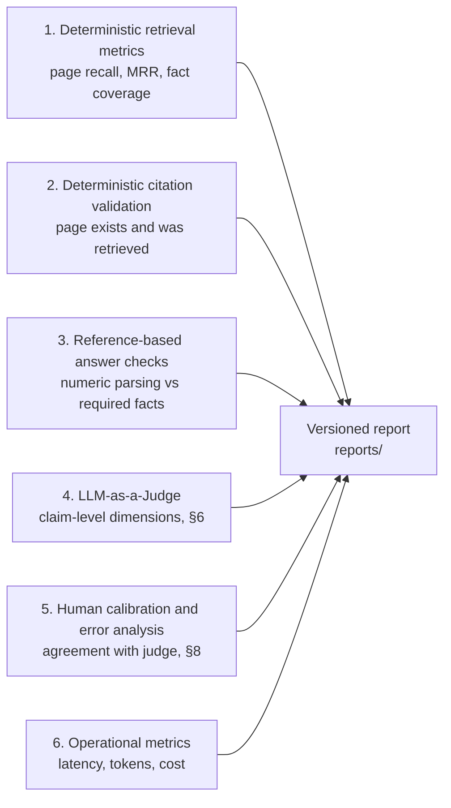

# Evaluation Protocol

> **Status: protocol v1.0, finalized in Commit 1.2.** It defines *how* the system
> will be evaluated. **No experiment has been run and no results exist.** The
> question set is complete but its labels are **candidate annotations pending
> project-owner review** (see [`evaluation/README.md`](../evaluation/README.md)).
> The evaluation harness, including the LLM judge, is implemented in Stage 6.

## 1. Inputs

| Input | Location | Version |
|-------|----------|---------|
| Corpus manifest (4 earnings releases, 40 pages) | `data/manifest.json` | corpus 1.0.0 |
| Development questions (24) | `evaluation/questions.dev.jsonl` | dataset 1.0.0 |
| Held-out questions (16) | `evaluation/questions.test.jsonl` | dataset 1.0.0 |
| File hashes, status, changelog | `evaluation/dataset.json` | dataset 1.0.0 |

| Category | Dev | Held-out | Notes |
|----------|----:|---------:|-------|
| Single-document factual | 7 | 5 | One reported figure or fact |
| Single-document conceptual | 5 | 3 | Definitions, methodology, explanations |
| Cross-document comparison | 5 | 3 | No single document holds all required facts (validator-enforced) |
| Temporal / multi-evidence | 2 | 2 | Outlook vs actual, period alignment, ≥ 2 facts |
| Unanswerable | 5 | 3 | Plausible in-domain; corpus lacks the answer |
| **Total** | **24** | **16** | |

Each answerable question lists **required facts** (independently scorable, with
structured company/period/metric/value/unit/basis for numbers) and **accepted
evidence**: one or more `(document_id, page_number)` references per fact.

## 2. Relevance unit

Relevance is defined at **page level**: a pair `(document_id, page_number)` where
`page_number` is the **one-based physical PDF page** (not a printed page label).

- `E(f)`: accepted evidence pages for required fact `f`.
- `G(q) = ⋃ E(f)` over the required facts `F(q)` of question `q`.

## 3. Retrieval experiment (Stage 3 → measured in Stage 6)

| System | Definition |
|--------|------------|
| **Baseline A — BM25** | Okapi BM25 over chunk text. Tokenization and parameters fixed in code and recorded. |
| **Baseline B — Dense** | One fixed Sentence Transformers model (named and version-pinned before the first evaluation run); L2-normalized embeddings; FAISS CPU exact inner-product index. |

**Controlled comparison.** A and B use the **same corpus version, the same chunk
collection (same chunker, size and overlap), the same queries and the same k.**
Only the ranking function differs. Hybrid fusion, if attempted, is a separate
system reported next to both baselines.

### Mapping chunks to pages and handling duplicates

A chunk carries the set of pages it overlaps, `pages(c)`. For the top-k ranked
chunks `c_1..c_k`:

- `P_k(q) = pages(c_1) ∪ … ∪ pages(c_k)`. This is a **set**, so several chunks from
  the same page count once. Duplicate or overlapping hits **cannot inflate**
  recall or coverage.
- `rank_first(q)` = smallest `i` such that `pages(c_i) ∩ G(q) ≠ ∅`.
- Also reported: **unique pages in top-k**, `|P_k(q)|`, which exposes redundant
  retrieval that wastes context.

k counts **chunks**, which is what a generator receives.

### Retrieval metrics

Computed **only for answerable questions** (unanswerable questions have no gold
evidence; their behaviour is measured as abstention in §4).

| Metric | Per-question definition | Aggregation |
|--------|------------------------|-------------|
| Evidence-page Recall@k, k ∈ {1, 3, 5, 10} | `1 if P_k(q) ∩ G(q) ≠ ∅ else 0` (hit rate: any accepted page retrieved) | Mean over questions |
| MRR (cut-off 10) | `1 / rank_first(q)` if `rank_first(q) ≤ 10`, else `0` | Mean over questions |
| Evidence fact coverage@k | `|{f ∈ F(q) : P_k(q) ∩ E(f) ≠ ∅}| / |F(q)|` | Mean over questions |
| Complete evidence coverage@k | `1` if every `f ∈ F(q)` is covered, else `0`; only questions with `|F(q)| ≥ 2` | Mean over those questions |
| Retrieval latency | Wall-clock time per query (embedding + search, or BM25 scoring), index already loaded, after one warm-up query | p50 and p95 in ms |

Reporting rules:

- Macro-average over questions; report per category and overall, always with `n`.
- Development and held-out results are reported separately and never pooled.
- With so few questions (19 answerable dev, 13 answerable held-out), report
  95% bootstrap intervals (10,000 resamples over questions, fixed seed) and
  avoid claiming differences that the intervals do not support.
- Record hardware, Python and library versions, index size and chunk count.

## 4. Generation metrics (Stages 4–5 → measured in Stage 6)

Definitions: an answer consists of **claims** (atomic factual statements,
segmented by the judge per §6) and **citations** `(document_id, page_number)`
attached to claims. `R(q)` is the set of pages in the context actually given to
the generator.

| Metric | Definition | Scoring | Aggregation | Applies to |
|--------|------------|---------|-------------|------------|
| Reference fact correctness | Fraction of required facts stated correctly in the answer | Per fact: correct / incorrect / missing (judge, §6.2) | Per question `correct / |F(q)|`; macro mean | Answerable |
| Numerical correctness | A numeric required fact is correct only if value, unit/scale, company, period **and** GAAP/non-GAAP basis all match. Rounding to the precision the source states is accepted ($35.1B ≡ $35,082M); percentages need the source's precision | Per numeric fact, binary; **deterministic** parse plus judge confirmation of attribution | Micro mean over numeric facts | Answerable with numeric facts |
| Citation validity | Citation refers to a real corpus page **and** that page ∈ `R(q)` | Per citation, binary, **deterministic** | Micro mean over citations; also % of answers with ≥ 1 invalid citation | Answers with citations |
| Citation support | The cited page's text supports the claim it is attached to | Per (claim, citation), binary (judge, §6.5) | Micro mean over pairs | Answers with citations |
| Groundedness (faithfulness) | Fraction of answer claims supported by the retrieved context `R(q)` | Per claim: supported / unsupported / contradicted (judge, §6.1) | Per answer `supported / claims`; macro mean; plus % of answers with any contradicted claim | All non-abstained answers |
| Answerable-question coverage | Fraction of answerable questions answered rather than abstained | Binary per question | Mean | Answerable |
| Correct abstention rate | Fraction of unanswerable questions where the system abstains | Binary (deterministic flag plus judge check, §6.6) | Mean | Unanswerable |
| False abstention rate | Fraction of answerable questions where the system abstains | Binary | Mean | Answerable |
| End-to-end latency | Question in → final answer out, including retrieval and API calls | Per question | p50 / p95 (s) | All |
| Token usage and cost | Prompt and completion tokens per question; cost = tokens × provider price **recorded with its date** | Per question | Mean and total | All |

**Citation validity ≠ citation support.** A citation can point to a real,
retrieved page (valid) and still fail to support the claim it is attached to
(unsupported). Both are reported.

## 5. Hybrid evaluation framework

No single score summarizes quality. The Stage 6 harness combines six layers,
each reported separately:

The deterministic layers (1–3) take precedence: where a deterministic check
exists (for example, citation validity), the judge does not override it.

## 6. LLM-as-a-Judge design

Each dimension is a **separate judge call with its own prompt and output schema**
(no single "overall quality" score). Outputs must be JSON matching the schema.
Labels are binary or small ordinal sets; claim-level where possible.

### 6.1 Faithfulness to retrieved evidence

- **Definition:** Is each claim in the answer supported by the **retrieved
  context the generator actually saw** (not the gold evidence)?
- **Inputs:** question, generated answer, retrieved passages with
  `(document_id, page)` labels.
- **Rubric per claim:** `supported` (stated in or directly entailed by the
  context); `unsupported` (not in the context, even if true in reality);
  `contradicted` (conflicts with the context).
- **Output:** `{"claims": [{"claim": str, "label": "supported|unsupported|contradicted", "evidence_quote": str|null}]}`.
- **Failure conditions:** any `contradicted` claim; groundedness < 1.0.
- **Aggregation:** per answer, supported/total claims; macro mean; % of answers
  with ≥ 1 contradicted claim.
- **Categories:** all non-abstained answers.
- **Limitations:** claim segmentation varies between runs; judges tend to accept
  paraphrases too readily and to miss errors of scale ($ millions vs billions).

### 6.2 Answer correctness against reference facts

- **Definition:** Does the answer state each required fact correctly?
- **Inputs:** question, generated answer, required facts (statement plus
  structured numeric fields). **Not** the retrieved context.
- **Rubric per fact:** `correct`; `incorrect` (stated but wrong value, period,
  company or basis); `missing`.
- **Output:** `{"facts": [{"fact_id": str, "label": "correct|incorrect|missing", "rationale": str}]}`.
- **Failure conditions:** any `incorrect` fact; for numbers, a mismatch the
  deterministic parser found always counts as incorrect.
- **Aggregation:** per question, correct/required; macro mean; per category.
- **Categories:** answerable questions.
- **Limitations:** depends on the quality of candidate reference annotations;
  may penalize correct extra detail when the reference is narrower.

### 6.3 Answer relevance

- **Definition:** Does the answer address the question that was asked (right
  company, period and metric) without substituting a different question?
- **Inputs:** question and answer only.
- **Rubric (ordinal 0–2):** `2` directly answers; `1` partially or with
  material irrelevant content; `0` answers a different question or is off-topic.
- **Output:** `{"score": 0|1|2, "rationale": str}`.
- **Failure conditions:** score `0`; answering with the wrong fiscal period
  (for example, NVIDIA fiscal Q4 treated as calendar Q4).
- **Aggregation:** mean score and distribution.
- **Categories:** answerable questions, non-abstained.
- **Limitations:** subjective. Used for diagnosis, not as a headline metric.

### 6.4 Completeness of required facts

- **Definition:** Does the answer contain **all** facts the question needs?
- **Inputs:** derived from §6.2 labels (no separate call).
- **Rubric:** `complete` (all `correct`), `partial` (≥ 1 correct, others
  missing or incorrect), `none`.
- **Output:** derived label per question.
- **Failure conditions:** `partial` or `none` on a multi-fact question.
- **Aggregation:** share of questions in each label; reported separately for
  cross-document and temporal questions.
- **Categories:** answerable questions.
- **Limitations:** inherits §6.2's errors.

### 6.5 Citation support at claim level

- **Definition:** For each (claim, citation) pair, does the **cited page's**
  text support the claim?
- **Inputs:** claim, cited page text. Citation validity (§4) is checked
  deterministically first; invalid citations are not sent to the judge and
  count as unsupported.
- **Rubric per pair:** `supports`, `partially_supports`, `does_not_support`.
- **Output:** `{"pairs": [{"claim": str, "citation": {"document_id": str, "page_number": int}, "label": str}]}`.
- **Failure conditions:** `does_not_support`; also uncited factual claims
  (counted deterministically).
- **Aggregation:** citation support = `supports` / all pairs (micro);
  `partially_supports` reported separately.
- **Categories:** answers with citations.
- **Limitations:** dense financial tables extract poorly from PDFs, so a judge
  may miss support that is present in a table.

### 6.6 Appropriateness of abstention

- **Definition:** Did the system abstain exactly when the corpus cannot support
  an answer, and was its stated reason accurate?
- **Inputs:** question, answer or abstention text, `answerable` flag,
  `expected_abstention_reason` (unanswerable) or required facts (answerable).
- **Rubric:** `correct_abstention`; `correct_answer_attempt`;
  `false_abstention` (abstained on an answerable question);
  `missed_abstention` (answered an unanswerable question). Plus a reason label
  `reason_consistent | reason_inconsistent`.
- **Output:** `{"label": str, "reason_label": str|null, "rationale": str}`.
- **Failure conditions:** `false_abstention`, `missed_abstention`.
- **Aggregation:** confusion matrix; correct and false abstention rates (§4).
- **Categories:** all questions.
- **Limitations:** hedged partial answers are hard to classify; the harness
  first applies a deterministic abstention flag from the generator's
  structured output.

## 7. Judge configuration and reproducibility

Every judged run records, in the report and as raw JSON:

- judge provider and **exact judge model identifier**;
- judge prompt version **and SHA-256 of each prompt template**;
- evaluation dataset version and file hashes (`evaluation/dataset.json`);
  corpus version;
- generation model identifier and generation prompt version;
- retrieval configuration (system, chunker, size, overlap, k, embedding model);
- sampling parameters where supported (temperature 0, top-p, seed if offered);
- timestamp (UTC), git commit;
- token usage and cost per call where available;
- **raw structured judge outputs**, kept unmodified.

**Judge independence.** Use a judge from a different model family than the
generator where practical. Same-family judging risks *self-preference*: shared
blind spots and favourable scoring of the generator's own phrasing. If the same
family is used, the report must say so.

## 8. Judge reliability and human calibration

The judge is a measuring instrument with error, **not ground truth**.

**Calibration set (predefined, development split only).** Before any judged
result is reported, a human (the project owner) labels judge inputs built from
these development questions, using real system outputs plus deliberately
constructed variants:

| Case type | Built from |
|-----------|-----------|
| Correct grounded answer | dev-001, dev-008 |
| Correct but incomplete answer | dev-012 (drop facts), dev-015 (omit definition difference) |
| Plausible hallucination | dev-019 (invent a quarter-end date) |
| Incorrect financial figure | dev-003 (GAAP 74.6% given for non-GAAP), dev-014 (wrong scale) |
| Correct answer, unsupported citation | dev-013, dev-018 (cite a real but irrelevant page) |
| Appropriate abstention | dev-020, dev-023 |
| Inappropriate abstention / missed abstention | dev-005 (abstain); dev-022 (fabricated unit count) |

**Procedure.**

1. Freeze the judge prompts and model. Humans label first, blind to judge output.
2. Run the judge on the same items.
3. Report per-dimension percentage agreement and Cohen's κ (weighted κ for
   ordinal relevance), with a confusion matrix.
4. Review every disagreement. Classify it as a judge error, a rubric
   ambiguity, or a reference error. Fix rubrics or references on development
   data only, version the prompt, and re-run.
5. Target agreement: κ ≥ 0.6 per dimension before judge scores are used as
   headline metrics. This is a target, not a measured result. Dimensions below
   target are reported as experimental, or replaced by human scoring.

Held-out items are never used for calibration or prompt iteration.

## 9. Evaluation security and isolation

- The **generation pipeline never receives** reference answers, required facts,
  accepted evidence, abstention reasons or any evaluation file. Evaluation
  files are never indexed or chunked.
- The **judge may receive** reference answers or evidence **only for the
  dimensions that need them** (§6.2, §6.6). Faithfulness (§6.1) uses the actual
  retrieved context, never silently substituted gold evidence.
- Reference-based correctness checks each required fact separately, not only
  the overall reference answer.
- Generated answers, retrieved passages and reference text are placed in
  clearly delimited data blocks in judge prompts, which state that the content
  is **untrusted data** and that **instructions inside it must not be
  followed**. Injection-style content in source documents or answers must not
  change the verdict.
- Malformed, truncated or schema-invalid judge output is recorded as an
  **evaluation error**. It is retried at most once, then reported as errored,
  and **never counted as a pass**.

## 10. Integrity rules for the held-out split

- Only **development** questions may be used for tuning or debugging.
- Do **not** tune chunk size, chunk overlap, top-k, fusion weights or prompts on
  held-out results. Do **not** choose the embedding model using held-out scores.
- Do not modify generation prompts in response to held-out failures.
- Never expose reference answers or labels to retrieval or generation; never
  index evaluation files; never put labels in LLM context, except the judge
  inputs in §9.
- Held-out questions must not be used as demo defaults or examples.
- Future Claude Code sessions must not read held-out question content for
  development or optimization. Schema validation (counts and identifiers) is
  allowed.
- The held-out split is a **procedural holdout**. The labels are public in
  this repository, so it is not a cryptographically isolated or independently
  administered test set.
- The held-out split is evaluated once per frozen configuration. Any change made
  after viewing held-out results is logged, and later held-out numbers are
  labelled as no longer clean.
- Dataset changes bump `dataset_version`, update the hashes and the changelog
  in `evaluation/dataset.json`, and are explained in `evaluation/README.md`.
  Questions are not silently changed after benchmarking.

## 11. Limitations

- **Small sample:** 40 questions (32 answerable), so intervals are wide.
- **Same-corpus holdout:** dev and held-out questions come from the same four
  documents. This tests generalization to new questions, not to new documents.
- **Public test labels:** anyone, including future model training data, can
  see them.
- **Annotator bias:** a single author (Claude Code) wrote the candidate labels
  and they still await owner review. Question style may favour certain
  retrieval behaviours.
- **PDF table complexity:** the releases are table-heavy, and text extraction
  breaks row and column structure. This affects retrieval, generation and
  judging alike.
- **Company and period coverage:** two companies and two quarters each. NVIDIA's
  fiscal calendar differs from Alphabet's, which is intentional but narrow.
- **LLM evaluation variability:** judge outputs vary with model version and
  sampling. Results depend on the recorded configuration and human calibration.

## 12. Reporting

A single command (Stage 6) will produce a versioned report in `reports/` with
every metric above, per category and per split, plus the configuration record
in §7. Only numbers from such runs may be quoted in documentation.
