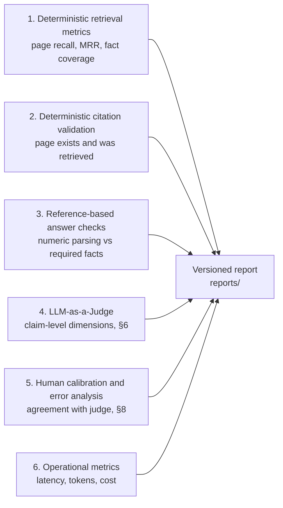

# Evaluation Protocol

> **Status: protocol v1.3.** It defines *how* the system will be evaluated.
> One authorized live diagnostic pilot has been run under v1.2 and is
> incomplete (`live-20261123T111430692539Z-8665d379`); development-split retrieval results
> are in [`retrieval_evaluation.md`](retrieval_evaluation.md). The question set
> (dataset v1.0.0) has been **reviewed by the project owner**, who accepted all
> 40 annotations without corrections, and is **frozen** (see
> [`evaluation/README.md`](../evaluation/README.md)). v1.1 states the retrieval
> metric definitions exactly (§3) and adds the benchmark freeze (§10). v1.2
> adds a narrowly scoped Stage 5 diagnostic amendment (§13). v1.3 adds
> prospective execution-complete reporting (§14). The formal
> evaluation harness, including the LLM judge, is implemented in Stage 6.

## 1. Inputs

| Input | Location | Version |
|-------|----------|---------|
| Corpus manifest (4 earnings releases, 40 pages) | `data/manifest.json` | corpus 1.0.0 |
| Development questions (24) | `evaluation/questions.dev.jsonl` | dataset 1.0.0 |
| Held-out questions (16) | `evaluation/questions.test.jsonl` | dataset 1.0.0 |
| File hashes, status, changelog | `evaluation/dataset.json` | dataset 1.0.0 |

| Category | Dev | Held-out | Notes |
|----------|----:|---------:|-------|
| Single-document factual | 7 | 5 | One reported figure or fact |
| Single-document conceptual | 5 | 3 | Definitions, methodology, explanations |
| Cross-document comparison | 5 | 3 | No single document holds all required facts (validator-enforced) |
| Temporal / multi-evidence | 2 | 2 | Outlook vs actual, period alignment, ≥ 2 facts |
| Unanswerable | 5 | 3 | Plausible in-domain; corpus lacks the answer |
| **Total** | **24** | **16** | |

Each answerable question lists **required facts** (independently scorable, with
structured company/period/metric/value/unit/basis for numbers) and **accepted
evidence**: one or more `(document_id, page_number)` references per fact.

## 2. Relevance unit

Relevance is defined at **page level**: a pair `(document_id, page_number)` where
`page_number` is the **one-based physical PDF page** (not a printed page label).

- `E(f)`: accepted evidence pages for required fact `f`.
- `G(q) = ⋃ E(f)` over the required facts `F(q)` of question `q`.

## 3. Retrieval experiment (Stage 3 → measured in Stage 6)

| System | Definition |
|--------|------------|
| **Baseline A — BM25** | Okapi BM25 over chunk text. Tokenization and parameters fixed in code and recorded. |
| **Baseline B — Dense** | One fixed Sentence Transformers model (named and version-pinned before the first evaluation run); L2-normalized embeddings; FAISS CPU exact inner-product index. |

**Controlled comparison.** A and B use the **same corpus version, the same chunk
collection (same chunker, size and overlap), the same queries and the same k.**
Only the ranking function differs. Hybrid fusion, if attempted, is a separate
system reported next to both baselines.

### Top-k, page identities and duplicates

A retriever returns a ranked list of chunks `c_1, c_2, …`. Each chunk carries
the set of page identities it overlaps, `pages(c)`, where a page identity is a
`(document_id, page_number)` pair.

1. **Top-k is the first k retrieved chunks**, `c_1..c_k`, exactly as ranked. k
   counts chunks, because chunks are what the generator receives.
2. **No deduplication happens before the cut.** Several chunks from the same
   page each take a slot in the top k. Redundant retrieval therefore costs
   rank positions, as it costs context in generation.
3. **Page identities are deduplicated only within those k chunks.**
   `P_k(q) = pages(c_1) ∪ … ∪ pages(c_k)` is a set, so a page retrieved by
   several chunks counts once. Duplicates cannot inflate recall or coverage.
4. Also reported: **unique pages in top-k**, `|P_k(q)|`, which exposes
   redundant retrieval.

**Interchangeable evidence.** A fact can have several accepted pages `E(f)`,
for example the same figure in a summary table and in a later comparison
column. They are alternatives, not a conjunction: retrieving **any one**
accepted page satisfies the fact at the page-annotation level.

**Page coverage is a proxy.** A covered fact means a top-k chunk overlaps an
accepted page. It does not prove that the chunk contains the supporting
passage: a chunk can overlap the right page and miss the relevant table row.
Whether the evidence actually reached the generator is measured separately, by
groundedness and citation support (§4, §6).

### Retrieval metrics

Computed **only for answerable questions** (unanswerable questions have no gold
evidence; their behaviour is measured as abstention in §4). `F(q)` is the
question's required facts, `E(f)` the accepted pages for fact `f`, and
`G(q) = ⋃ E(f)`.

| Metric | Per-question definition | Aggregation |
|--------|------------------------|-------------|
| **Evidence-page Recall@k**, k ∈ {1, 3, 5, 10} | `1 if P_k(q) ∩ G(q) ≠ ∅ else 0`: at least one accepted page of any required fact is in the top k. This is a hit rate, not a fraction of pages retrieved. | Mean over questions |
| **Required-fact coverage@k** | `|{f ∈ F(q) : P_k(q) ∩ E(f) ≠ ∅}| / |F(q)|`: the fraction of required facts with at least one accepted page in the top k | Mean over questions |
| **Complete required-fact coverage@k** | `1` if every `f ∈ F(q)` has an accepted page in `P_k(q)`, else `0`. Reported over questions with `|F(q)| ≥ 2`; for a single-fact question it equals Recall@k. | Mean over those questions |
| **Mean Reciprocal Rank** (cut-off 10) | `1 / rank_first(q)`, where `rank_first(q)` is the smallest chunk rank `i` with `pages(c_i) ∩ G(q) ≠ ∅`. Ranks count chunks before any deduplication. `0` if no such `i ≤ 10`. | Mean over questions |
| Retrieval latency | Wall-clock time per query (embedding + search, or BM25 scoring), index already loaded, after one warm-up query | p50 and p95 in ms |

Recall@k asks whether *any* evidence was found. Required-fact coverage asks how
much of the *needed* evidence was found, and complete coverage asks whether
*all* of it was. For cross-document questions these can differ sharply:
retrieving one company's page gives Recall@k = 1 but only partial coverage.

Reporting rules:

- Macro-average over questions; report per category and overall, always with `n`.
- Development and held-out results are reported separately and never pooled.
- With so few questions (19 answerable dev, 13 answerable held-out), report
  95% bootstrap intervals (10,000 resamples over questions, fixed seed) and
  avoid claiming differences that the intervals do not support.
- Record hardware, Python and library versions, index size and chunk count.

## 4. Generation metrics (Stages 4–5 → measured in Stage 6)

Definitions: an answer consists of **claims** (atomic factual statements,
segmented by the judge per §6) and **citations** `(document_id, page_number)`
attached to claims. `R(q)` is the set of pages in the context actually given to
the generator.

| Metric | Definition | Scoring | Aggregation | Applies to |
|--------|------------|---------|-------------|------------|
| Reference fact correctness | Fraction of required facts stated correctly in the answer | Per fact: correct / incorrect / missing (judge, §6.2) | Per question `correct / |F(q)|`; macro mean | Answerable |
| Numerical correctness | A numeric required fact is correct only if value, unit/scale, company, period **and** GAAP/non-GAAP basis all match. Rounding to the precision the source states is accepted ($35.1B ≡ $35,082M); percentages need the source's precision | Per numeric fact, binary; **deterministic** parse plus judge confirmation of attribution | Micro mean over numeric facts | Answerable with numeric facts |
| Citation validity | Citation refers to a real corpus page **and** that page ∈ `R(q)` | Per citation, binary, **deterministic** | Micro mean over citations; also % of answers with ≥ 1 invalid citation | Answers with citations |
| Citation support | The cited page's text supports the claim it is attached to | Per (claim, citation), binary (judge, §6.5) | Micro mean over pairs | Answers with citations |
| Groundedness (faithfulness) | Fraction of answer claims supported by the retrieved context `R(q)` | Per claim: supported / unsupported / contradicted (judge, §6.1) | Per answer `supported / claims`; macro mean; plus % of answers with any contradicted claim | All non-abstained answers |
| Answerable-question coverage | Fraction of answerable questions answered rather than abstained | Binary per question | Mean | Answerable |
| Correct abstention rate | Fraction of unanswerable questions where the system abstains | Binary (deterministic flag plus judge check, §6.6) | Mean | Unanswerable |
| False abstention rate | Fraction of answerable questions where the system abstains | Binary | Mean | Answerable |
| End-to-end latency | Question in → final answer out, including retrieval and API calls | Per question | p50 / p95 (s) | All |
| Token usage and cost | Prompt and completion tokens per question; cost = tokens × provider price **recorded with its date** | Per question | Mean and total | All |

**Citation validity ≠ citation support.** A citation can point to a real,
retrieved page (valid) and still fail to support the claim it is attached to
(unsupported). Both are reported.

## 5. Hybrid evaluation framework

No single score summarizes quality. The Stage 6 harness combines six layers,
each reported separately:

The deterministic layers (1–3) take precedence: where a deterministic check
exists (for example, citation validity), the judge does not override it.

## 6. LLM-as-a-Judge design

Each dimension is a **separate judge call with its own prompt and output schema**
(no single "overall quality" score). Outputs must be JSON matching the schema.
Labels are binary or small ordinal sets; claim-level where possible.

### 6.1 Faithfulness to retrieved evidence

- **Definition:** Is each claim in the answer supported by the **retrieved
  context the generator actually saw** (not the gold evidence)?
- **Inputs:** question, generated answer, retrieved passages with
  `(document_id, page)` labels.
- **Rubric per claim:** `supported` (stated in or directly entailed by the
  context); `unsupported` (not in the context, even if true in reality);
  `contradicted` (conflicts with the context).
- **Output:** `{"claims": [{"claim": str, "label": "supported|unsupported|contradicted", "evidence_quote": str|null}]}`.
- **Failure conditions:** any `contradicted` claim; groundedness < 1.0.
- **Aggregation:** per answer, supported/total claims; macro mean; % of answers
  with ≥ 1 contradicted claim.
- **Categories:** all non-abstained answers.
- **Limitations:** claim segmentation varies between runs; judges tend to accept
  paraphrases too readily and to miss errors of scale ($ millions vs billions).

### 6.2 Answer correctness against reference facts

- **Definition:** Does the answer state each required fact correctly?
- **Inputs:** question, generated answer, required facts (statement plus
  structured numeric fields). **Not** the retrieved context.
- **Rubric per fact:** `correct`; `incorrect` (stated but wrong value, period,
  company or basis); `missing`.
- **Output:** `{"facts": [{"fact_id": str, "label": "correct|incorrect|missing", "rationale": str}]}`.
- **Failure conditions:** any `incorrect` fact; for numbers, a mismatch the
  deterministic parser found always counts as incorrect.
- **Aggregation:** per question, correct/required; macro mean; per category.
- **Categories:** answerable questions.
- **Limitations:** depends on the quality of the reference annotations;
  may penalize correct extra detail when the reference is narrower.

### 6.3 Answer relevance

- **Definition:** Does the answer address the question that was asked (right
  company, period and metric) without substituting a different question?
- **Inputs:** question and answer only.
- **Rubric (ordinal 0–2):** `2` directly answers; `1` partially or with
  material irrelevant content; `0` answers a different question or is off-topic.
- **Output:** `{"score": 0|1|2, "rationale": str}`.
- **Failure conditions:** score `0`; answering with the wrong fiscal period
  (for example, NVIDIA fiscal Q4 treated as calendar Q4).
- **Aggregation:** mean score and distribution.
- **Categories:** answerable questions, non-abstained.
- **Limitations:** subjective. Used for diagnosis, not as a headline metric.

### 6.4 Completeness of required facts

- **Definition:** Does the answer contain **all** facts the question needs?
- **Inputs:** derived from §6.2 labels (no separate call).
- **Rubric:** `complete` (all `correct`), `partial` (≥ 1 correct, others
  missing or incorrect), `none`.
- **Output:** derived label per question.
- **Failure conditions:** `partial` or `none` on a multi-fact question.
- **Aggregation:** share of questions in each label; reported separately for
  cross-document and temporal questions.
- **Categories:** answerable questions.
- **Limitations:** inherits §6.2's errors.

### 6.5 Citation support at claim level

- **Definition:** For each (claim, citation) pair, does the **cited page's**
  text support the claim?
- **Inputs:** claim, cited page text. Citation validity (§4) is checked
  deterministically first; invalid citations are not sent to the judge and
  count as unsupported.
- **Rubric per pair:** `supports`, `partially_supports`, `does_not_support`.
- **Output:** `{"pairs": [{"claim": str, "citation": {"document_id": str, "page_number": int}, "label": str}]}`.
- **Failure conditions:** `does_not_support`; also uncited factual claims
  (counted deterministically).
- **Aggregation:** citation support = `supports` / all pairs (micro);
  `partially_supports` reported separately.
- **Categories:** answers with citations.
- **Limitations:** dense financial tables extract poorly from PDFs, so a judge
  may miss support that is present in a table.

### 6.6 Appropriateness of abstention

- **Definition:** Did the system abstain exactly when the corpus cannot support
  an answer, and was its stated reason accurate?
- **Inputs:** question, answer or abstention text, `answerable` flag,
  `expected_abstention_reason` (unanswerable) or required facts (answerable).
- **Rubric:** `correct_abstention`; `correct_answer_attempt`;
  `false_abstention` (abstained on an answerable question);
  `missed_abstention` (answered an unanswerable question). Plus a reason label
  `reason_consistent | reason_inconsistent`.
- **Output:** `{"label": str, "reason_label": str|null, "rationale": str}`.
- **Failure conditions:** `false_abstention`, `missed_abstention`.
- **Aggregation:** confusion matrix; correct and false abstention rates (§4).
- **Categories:** all questions.
- **Limitations:** hedged partial answers are hard to classify; the harness
  first applies a deterministic abstention flag from the generator's
  structured output.

## 7. Judge configuration and reproducibility

Every judged run records, in the report and as raw JSON:

- judge provider and **exact judge model identifier**;
- judge prompt version **and SHA-256 of each prompt template**;
- evaluation dataset version and file hashes (`evaluation/dataset.json`);
  corpus version;
- generation model identifier and generation prompt version;
- retrieval configuration (system, chunker, size, overlap, k, embedding model);
- sampling parameters where supported (temperature 0, top-p, seed if offered);
- timestamp (UTC), git commit;
- token usage and cost per call where available;
- **raw structured judge outputs**, kept unmodified.

**Judge independence.** Use a judge from a different model family than the
generator where practical. Same-family judging risks *self-preference*: shared
blind spots and favourable scoring of the generator's own phrasing. If the same
family is used, the report must say so.

## 8. Judge reliability and human calibration

The judge is a measuring instrument with error, **not ground truth**.

**Calibration set (predefined, development split only).** Before any judged
result is reported, a human (the project owner) labels judge inputs built from
these development questions, using real system outputs plus deliberately
constructed variants:

| Case type | Built from |
|-----------|-----------|
| Correct grounded answer | dev-001, dev-008 |
| Correct but incomplete answer | dev-012 (drop facts), dev-015 (omit definition difference) |
| Plausible hallucination | dev-019 (invent a quarter-end date) |
| Incorrect financial figure | dev-003 (GAAP 74.6% given for non-GAAP), dev-014 (wrong scale) |
| Correct answer, unsupported citation | dev-013, dev-018 (cite a real but irrelevant page) |
| Appropriate abstention | dev-020, dev-023 |
| Inappropriate abstention / missed abstention | dev-005 (abstain); dev-022 (fabricated unit count) |

**Procedure.**

1. Freeze the judge prompts and model. Humans label first, blind to judge output.
2. Run the judge on the same items.
3. Report per-dimension percentage agreement and Cohen's κ (weighted κ for
   ordinal relevance), with a confusion matrix.
4. Review every disagreement. Classify it as a judge error, a rubric
   ambiguity, or a reference error. Fix rubrics or references on development
   data only, version the prompt, and re-run.
5. Target agreement: κ ≥ 0.6 per dimension before judge scores are used as
   headline metrics. This is a target, not a measured result. Dimensions below
   target are reported as experimental, or replaced by human scoring.

Held-out items are never used for calibration or prompt iteration.

## 9. Evaluation security and isolation

- The **generation pipeline never receives** reference answers, required facts,
  accepted evidence, abstention reasons or any evaluation file. Evaluation
  files are never indexed or chunked.
- The **judge may receive** reference answers or evidence **only for the
  dimensions that need them** (§6.2, §6.6). Faithfulness (§6.1) uses the actual
  retrieved context, never silently substituted gold evidence.
- Reference-based correctness checks each required fact separately, not only
  the overall reference answer.
- Generated answers, retrieved passages and reference text are placed in
  clearly delimited data blocks in judge prompts, which state that the content
  is **untrusted data** and that **instructions inside it must not be
  followed**. Injection-style content in source documents or answers must not
  change the verdict.
- Malformed, truncated or schema-invalid judge output is recorded as an
  **evaluation error**. It is retried at most once, then reported as errored,
  and **never counted as a pass**.

## 10. Benchmark freeze and integrity rules for the held-out split

Dataset v1.0.0 is **frozen**. Later stages may tune the system on development
questions only. Held-out questions must not guide document preprocessing,
chunk size or overlap, embedding model selection, retrieval configuration,
generation prompts, or judge prompts and calibration.

- Only **development** questions may be used for tuning or debugging.
- Do **not** tune chunk size, chunk overlap, top-k, fusion weights or prompts on
  held-out results. Do **not** choose the embedding model using held-out scores.
- Do not modify generation prompts in response to held-out failures.
- Never expose reference answers or labels to retrieval or generation; never
  index evaluation files; never put labels in LLM context, except the judge
  inputs in §9.
- Held-out questions must not be used as demo defaults or examples.
- Future Claude Code sessions must not read held-out question content for
  development or optimization. Schema validation (counts and identifiers) is
  allowed.
- The held-out split is a **procedural holdout**. The labels are public in
  this repository, so it is not a cryptographically isolated or independently
  administered test set.
- The held-out split is evaluated once per frozen configuration. Any change made
  after viewing held-out results is logged, and later held-out numbers are
  labelled as no longer clean.
- Dataset changes bump `dataset_version`, update the hashes and the changelog
  in `evaluation/dataset.json`, and are explained in `evaluation/README.md`.
  Questions are not silently changed after benchmarking.

## 11. Limitations

- **Small sample:** 40 questions (32 answerable), so intervals are wide.
- **Same-corpus holdout:** dev and held-out questions come from the same four
  documents. This tests generalization to new questions, not to new documents.
- **Public test labels:** anyone, including future model training data, can
  see them.
- **Annotator bias:** a single author (Claude Code) wrote the labels and a
  single reviewer (the project owner) accepted them. There was no independent
  second annotation and no inter-annotator agreement measurement. Question
  style may favour certain retrieval behaviours.
- **PDF table complexity:** the releases are table-heavy, and text extraction
  breaks row and column structure. This affects retrieval, generation and
  judging alike.
- **Company and period coverage:** two companies and two quarters each. NVIDIA's
  fiscal calendar differs from Alphabet's, which is intentional but narrow.
- **LLM evaluation variability:** judge outputs vary with model version and
  sampling. Results depend on the recorded configuration and human calibration.

## 12. Reporting

A single command (Stage 6) will produce a versioned report in `reports/` with
every metric above, per category and per split, plus the configuration record
in §7. Only numbers from such runs may be quoted in documentation, with one
exception: approved Stage 5 deterministic diagnostics (§13, with §14
completion states for runs under v1.3).

## 13. Stage 5 diagnostic amendment (v1.2)

**Why.** Stage 5 must report cross-document and unanswerable category results.
Before v1.2, §4 reserved generation metrics for Stage 6, several §4 metrics
need the judge (§6), judge scores need human calibration first (§8), and §12
allowed only Stage 6 numbers to be quoted. v1.2 adds one narrow exception: a
deterministic **diagnostic** report. Nothing in §1–§12 is weakened.

**Unchanged.** Questions, labels, required facts, accepted evidence, the
dataset version, the category distribution, every §3–§8 definition, the judge
design, the κ ≥ 0.6 calibration target, the isolation rules (§9) and the
held-out freeze (§10).

**Classification and caveat.** Every report carries
`evaluation_kind: diagnostic_deterministic` and this caveat, verbatim:

> These diagnostics do not establish answer correctness, faithfulness,
> claim-level citation support or semantic abstention appropriateness. Formal
> evaluation remains pending Stage 6.

**Scope.**
- Development split only (24 questions), through the hash-checked
  development loader. The held-out file is never opened.
- The pipeline receives the question text only. Required facts and accepted
  evidence are used only in scoring. Reference answers and expected abstention
  reasons are not read.
- One frozen generation per question, one citation resolution and one
  deterministic guardrail check of that same response. No judge, no repair, no
  fallback, no rewriting.

**Metrics.** Every metric reports its eligible population, numerator and
denominator, overall and per category. A zero denominator is reported as
`not_applicable`, never as zero.

| Metric | Per-question definition | Eligible population |
|---|---|---|
| Execution outcome | `completed`, `failed` (error category), `not_run_budget`, `not_run_aborted`, `not_run_interrupted`, `not_replayable` | all questions |
| Status distribution | answered, partially_answered, insufficient_evidence, local_abstention | completed questions |
| `answer_attempt_rate` | answered or partially_answered | completed answerable |
| `abstention_on_answerable_rate` | insufficient_evidence or local abstention | completed answerable |
| `abstention_on_unanswerable_rate` | insufficient_evidence or local abstention | completed unanswerable |
| `answered_on_unanswerable_rate` | answered | completed unanswerable |
| `partially_answered_on_unanswerable_rate` | partially_answered, never folded into either of the above | completed unanswerable |
| `selected_evidence_page_recall` | §3 Recall over the distinct pages of the model-visible evidence | completed answerable |
| `selected_evidence_fact_coverage` | §3 required-fact coverage over those pages | completed answerable |
| `selected_evidence_complete_fact_coverage` | every required fact has an accepted selected page | completed answerable with ≥ 2 facts |
| `cited_evidence_page_recall`, `cited_evidence_fact_coverage`, `cited_evidence_complete_fact_coverage` | the same over the distinct pages of the cited evidence | completed answerable with an answer attempt (and ≥ 2 facts for complete) |
| `accepted_page_citation_overlap` | distinct cited (document, page) pairs that are accepted pages | distinct cited pages in answerable answer attempts (micro) |
| Citation structural invariants | each citation's chunk, document and page equal its selected evidence | all citations |
| Guardrail findings | counts by finding category × severity, numeric trace counts, questions with ≥ 1 warning | completed questions with completed checks |
| Provider usage | provider-reported tokens; `None` stays not reported | completed questions answered by the provider |
| Local token estimates | local tokenizer count of instructions + input, labelled as an estimate | same |
| Latency | context, provider and total ms, p50 and p95 (operational section) | completed questions |

- Pages are deduplicated per question at the (document, page) level before
  any page metric, so several chunks or citations on one page count once.
  Citation counts are reported separately and never stand in for page
  coverage.
- Abstention metrics are **operational flags**. An abstention on a question
  labelled unanswerable is not called correct: whether the stated reason is
  appropriate is §6.6, a judge dimension.
- `accepted_page_citation_overlap` is a **reference-alignment diagnostic**:
  how far the cited pages coincide with the annotated accepted pages. It is
  not semantic citation precision, claim-level support, verified
  faithfulness or a bound on factual correctness. A cited accepted page
  does not establish that the passage supports the claim, and a
  non-accepted page may also support it, because accepted evidence is not
  exhaustive.
- Alternative accepted pages for one fact are alternatives, exactly as in
  §3: any one of them covers the fact.
- Not implemented here, and still Stage 6: reference fact correctness,
  numerical correctness, groundedness, citation support, completeness,
  relevance and judge-checked abstention appropriateness.

**Small samples.** Overall and per-category rates use the §3 percentile
bootstrap (10,000 resamples, fixed seed) with a small-sample warning below 10
questions. Categories with fewer than 5 dataset questions (temporal, n = 2)
report counts only.

**Failures.** Authentication, permission, quota, model-availability and
configuration failures abort a live run; later questions are
`not_run_aborted`. Transport, timeout, rate-limit and server errors are
failures, with no retry. Refusals, incomplete generations and invalid
structured output are failures, never abstentions. Citation-resolution
failures are failures. A guardrail failure keeps the generated response and
marks only the diagnostics as failed. Local abstentions are completed
outcomes. Failed and unrun questions are excluded from rate denominators but
always counted, per category. Raw provider messages are never recorded.

**Failure diagnostics (record schema 2).** Each failed record carries a
`failure` block with codes only:
- `stage`: `generation` (context or provider request), `answer_validation`
  (local response invariants on a parsed provider answer),
  `citation_resolution`, or `replay_verification`;
- `error_category`, the sanitized provider `request_id` and HTTP
  `status_code` when known;
- `problems`: one entry per violated invariant, with a stable `code`
  (`insufficient_evidence_has_claims`, `claims_required`,
  `answered_has_limitations`, `limitations_required`, `blank_limitation`,
  `blank_claim_text`, `claim_cites_no_evidence`, `duplicate_evidence_id`,
  `malformed_evidence_id`, `unknown_evidence_id`), one-based claim, evidence
  reference or limitation positions, and the model-supplied evidence ID passed
  through `safe_token` and cut to 32 characters;
- `usage_recorded`.

The rejected answer, its text, the prompt, the question, passages and
exception messages are never stored. A response-contract violation stays a
failure: no repair, retry, fallback or status change. When the provider
reported usage for a rejected answer, the record keeps it.

**Usage accounting.** Provider usage is summed over every attempted request,
failures included. Reports show `attempted_requests`, `requests_with_usage`
and `usage_complete`; usage the provider did not report stays unknown
(`None`), never zero, and incomplete totals are labelled as understating
spend.

**Record schema versions.** Version 2 adds the failure block and the usage of
rejected answers. Version 1 records (Commit 6.3) remain replayable: their
completed answers replay as before, and their failures are reported with
`failure_diagnostics: not_recorded_in_record_schema_1` rather than invented
details. A replay refuses records that mix schema versions or use an unknown
one. Existing runs are never rewritten.

**Run completion.** A run is complete only if every development question is
`completed` exactly once, every guardrail check completed, and the run was
neither aborted nor interrupted. Runs are never merged. An incomplete run is
never presented as a 24-question result.

**Provenance.** Every record and report carries its execution mode
(`dry_run`, `live`, `replay`) and its **origin**: the mode and run ID of
the run that produced the answers. A replay keeps its source run's origin,
so a replay of a dry run is still synthetic and a replay of a live run keeps
the live run ID. Replays add no provider-usage or latency observations.

**Exception to §12.** Only a **complete** run whose origin is `live` (the
live run itself, or a replay of it) may be quoted in documentation, as a
Stage 5 diagnostic of the hosted model: labelled `diagnostic_deterministic`,
with denominators, the origin run ID and the command. Reportability follows
the origin, never the current execution mode. Dry runs and replays of dry
runs come from a synthetic placeholder provider and are never evidence of
model performance. An incomplete run is never reportable.

**Paid execution.** Never automatic. A live run needs `--live`,
`FOUNDERLENS_RUN_PAID_EVAL=1`, an explicit `--max-requests N` (1–24, no
default), a clean Git working tree, the frozen identities and locally
configured credentials. The budget counts attempted requests, including
failed ones, and is enforced before sending. SDK retries are disabled; the
semantic model configuration is unchanged. Cost is estimated only from a
price and effective date the user supplies.

**Replay.** A replay rebuilds each request through the frozen pipeline,
requires the exact stored request and instruction hashes and identities,
revalidates the stored answer through the unchanged service and resolver,
requires identical citation associations and recomputes the guardrails. It
rejects modified, mixed-run, duplicate, provenance-inconsistent or
incompatible records. Each record's SHA-256 digest detects accidental
modification or truncation; it is not a signature and does not prevent
deliberate forgery. Replay reproduces neither model sampling nor provider
latency, and reports the original run's usage separately.

**Privacy.** The aggregate JSON and Markdown hold IDs, codes and numbers only.
The per-question records hold validated answers and citation associations
(never question text) for replay, human review and Stage 6 judging. All three
are git-ignored private evaluation artifacts.

**Tuning.** Development results produced after any change motivated by them
(for example Commit 6.4) are labelled post-tuning. Stage 6 human calibration
(§8) is still required before any judge score is reported.

## 14. Execution-complete reporting amendment (v1.3)

**Why.** The first authorized live diagnostic run, `live-20261123T111430692539Z-8665d379`, ran under v1.2:
24 scheduled questions, 24 provider attempts, 23 valid outcomes and one
`response_contract` failure. v1.2 makes a run reportable only if every answer
is valid. Repeating runs until one succeeds would then select for success:
the reported failure rate would be zero by construction, and failures, which
tend to occur on harder questions, would be filtered out. The pilot's failure
motivated this amendment; no metric value did.

**Prospective only.** v1.3 applies to runs started under it (record schema 3,
`protocol_version: "1.3"`). Records of schemas 1 and 2 keep v1.2 semantics,
including on replay, and are never upgraded. The pilot stays **incomplete and
not reportable**; it may be cited only as a disclosed pilot.

**Unchanged.** Questions, labels, accepted evidence, the frozen pipeline and
identities, §13 metric definitions, the caveat, the judge design and §8
calibration, isolation and the held-out freeze.

**Execution outcomes.** Every scheduled question ends as exactly one of
`valid_answer`, `local_abstention`, `model_output_failure`,
`infrastructure_failure`, `integrity_failure` or `not_run` (budget, abort,
interruption, or an unreplayable source).

**Failure taxonomy** (stage and category together; anything not listed,
including unknown combinations, is an integrity failure):

| Class | Stage / category |
|---|---|
| model output | `answer_validation/response_contract` (the provider's parsed answer broke a response invariant), `generation/refusal`, `generation/incomplete`, `generation/structured_output_invalid` |
| infrastructure | `generation/` `timeout`, `connection`, `rate_limited`, `provider_server_error`, `authentication`, `permission_denied`, `quota_exceeded`, `model_unavailable`, `configuration` |
| integrity | everything else, e.g. `citation_resolution/*` (including the resolver's own `response_contract` revalidation), `replay_verification/*`, `generation/unexpected_response`, context errors, unknown categories |

**Completion states** (mutually exclusive):

| State | Definition | Reportable when the origin is live |
|---|---|---|
| `answer_complete` | every question has a valid answer or local abstention; every guardrail check completed | yes |
| `execution_complete` | every question reached a terminal outcome; at least one model-output failure; nothing else wrong | yes, with every model-output failure counted |
| `incomplete` | any infrastructure or integrity failure, guardrail failure, unrun question, interruption, abort, or structural problem (coverage, mixed identities, protocol or origin) | no |

Reportability requires a live origin, protocol 1.3, one of the first two
states, every scheduled question accounted for exactly once, and consistent
frozen identities and provenance. A replay keeps its source run's protocol,
origin and state. Dry runs and their replays are never hosted-model evidence.

**Denominators.** Every metric states its eligible population, numerator and
denominator; a zero denominator is `not_applicable`.
- *Conditional* metrics (the §13 table) are over valid outcomes. Each one
  reports `excluded_scheduled`: the scheduled questions of its population
  and how many were left out, by outcome.
- *Unconditional* metrics are over scheduled questions with a terminal
  outcome, where a model-output failure is a separate outcome, never an
  attempt, partial answer or abstention:
  - the scheduled-question outcome distribution;
  - `contract_valid_outcome_rate`: valid answers and local abstentions over
    terminal questions;
  - `model_output_failure_rate`: model-output failures over terminal
    questions the provider answered;
  - failure counts by class and category;
  - unconditional answer-attempt, abstention and answered or partially
    answered flags for answerable and unanswerable questions.
- Retrieval (selected-evidence) metrics include a failed question when the
  evidence of the request actually sent was recorded (`selected_evidence_source:
  model_facing_request`: evidence IDs, documents and pages from that request,
  tied to it by its hashes; nothing is retrieved again). Questions without a
  recorded observation are excluded and counted, never reconstructed.
- Answer-dependent metrics (cited coverage, accepted-page overlap, guardrail
  findings) stay conditional on valid answers.
- Sample sizes stay small (temporal n = 2, unanswerable n = 5): §13 counts-only
  and small-sample rules still apply.

**Selection rule and run log.** Report the first execution-complete live run
under v1.3, and disclose every other run. Before any live provider exists,
the harness appends a `preregistered` entry to the git-ignored
`reports/generation_eval/run_log.jsonl`: run ID, UTC start, Git commit and
clean state, protocol, dataset hashes, every frozen identity, the request cap
and the selection rule. When the run ends it appends `finished`: completion
state, reportability, outcome and failure counts, attempts, interruption and
abort. A run with only a `preregistered` entry is unfinished. Entries are
appended, flushed and never rewritten; the file is local and not
tamper-proof. Runs left incomplete by infrastructure failures are disclosed
and investigated; nothing is rerun automatically.

**Disclosure.** Every report states the protocol, completion state, all
model-output failures, missing provider usage (`usage_complete: false`) and
sample sizes. None of this is answer correctness, faithfulness or semantic
citation support, and Stage 6 judge calibration is still required. A
contract-valid outcome is structurally valid under the response contract, not
factually correct.

**Artifact contents.**

| Artifact | Contains | Never contains |
|---|---|---|
| per-question records (`*.records.jsonl`, private, git-ignored) | for valid answers: the validated structured answer (claim text, claim types, evidence IDs, limitations), citation associations, selected-evidence provenance, request hashes, usage, timings, guardrail metadata; for failures: the typed failure block, request hashes, evidence provenance from the sent request, provider usage | question text, prompts, passages, a rejected answer's text, raw provider errors, credentials |
| aggregate JSON and Markdown summary | IDs, codes, counts, rates, identities | any question, answer, limitation or passage text |
| run log | run IDs, timestamps, Git state, identities, dataset hashes, request cap, completion states, outcome counts | any question, answer or passage text |

**Replay of failures.** A successful record replays without any provider
request: the rebuilt request must match its stored hashes, and the stored
answer is revalidated through the unchanged service and resolver. A recorded
failure is never re-inferred: it replays as `not_replayable` with its original
execution outcome, error category, typed failure block, request hashes and
captured evidence provenance carried from the digest-checked source record.
No new usage or provider attempt is recorded (the original usage stays in
`replay_of`), so the replay reports the same completion state, reliability
and retrieval metrics as its source.
